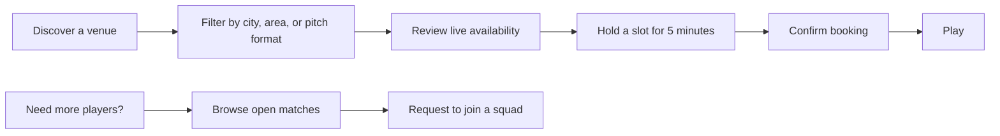
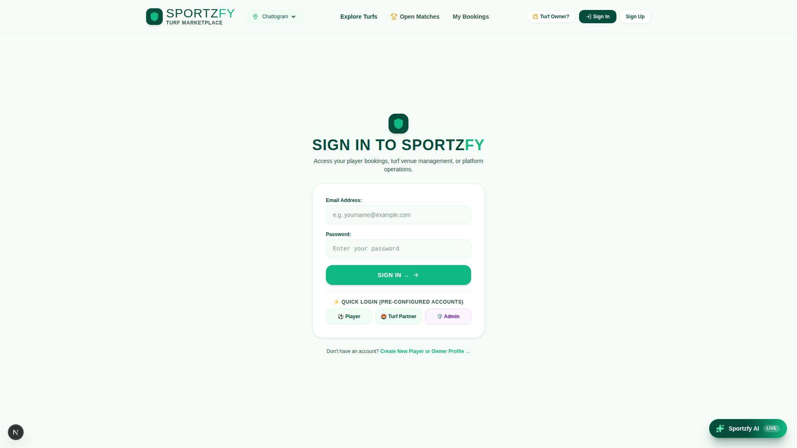
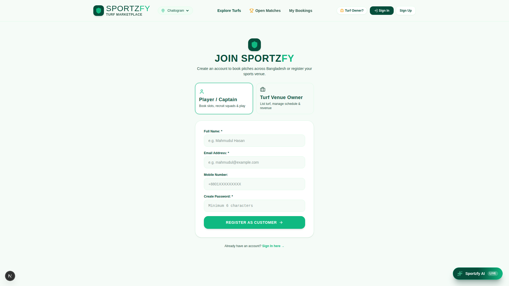
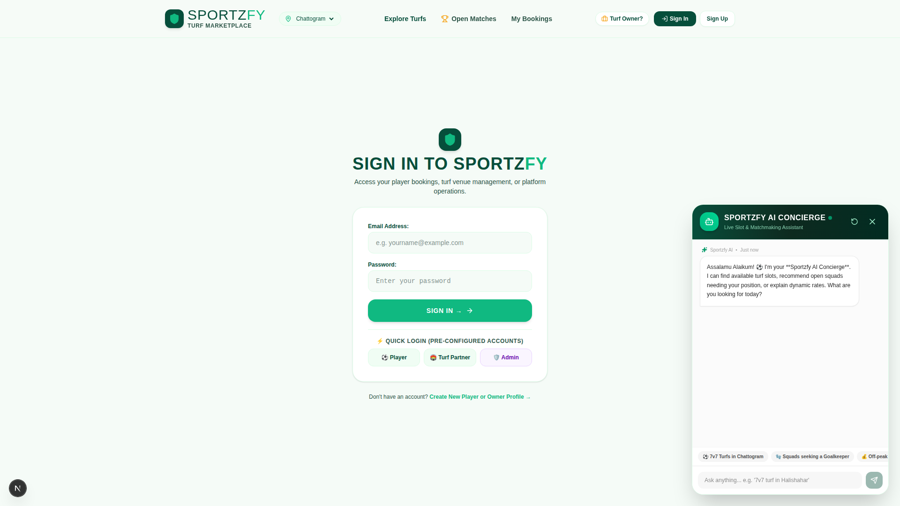

<div align="center">
  

  <h1>Sportzfy</h1>
  <p><strong>Bangladesh's turf booking and sports matchmaking marketplace.</strong></p>
  <p>Discover verified pitches, lock a slot, build a squad, and get on the field.</p>

  <p>
    <a href="https://sportzfy-zeta.vercel.app/"><strong>Open the live app ↗</strong></a>
    ·
    <a href="./sportzfy-web/README.md">Web app docs</a>
    ·
    <a href="./DEPLOYMENT.md">Deployment guide</a>
  </p>

  <p>
    
    
    
    
    
  </p>
</div>

## What is Sportzfy?

Sportzfy turns the informal turf-booking experience into one reliable flow. Players can search venues across Chattogram and Dhaka, compare pitch formats and facilities, see live availability, hold a slot for five minutes, and complete a booking without double-booking.

The platform also gives players a way to find teammates and gives venue owners a focused workspace for schedules, listings, blocked intervals, and operational analytics.

## Product walkthrough



### Player journey

1. Open the [live Sportzfy app](https://sportzfy-zeta.vercel.app/).
2. Search by venue, city, area, date, or format such as `5v5`, `6v6`, `7v7`, or cricket.
3. Open a verified venue to compare facilities, pricing, and available slots.
4. Select a slot and place a five-minute hold while you complete checkout.
5. View confirmed reservations from **My Bookings**.
6. Visit **Open Matches** to join a squad when you need teammates.

### Owner journey

1. Sign in through the owner workspace.
2. Add or edit a venue with pitch formats, facilities, photos, and location.
3. Manage the schedule, walk-ins, maintenance blocks, and availability.
4. Review bookings and use the owner dashboard to monitor the venue.

### Interface preview

The following captures show the current app interface and the main entry points for players:

<table>
  <tr>
    <td width="50%"></td>
    <td width="50%"></td>
  </tr>
  <tr>
    <td align="center"><sub>Player, owner, and admin sign-in</sub></td>
    <td align="center"><sub>Create a player or owner profile</sub></td>
  </tr>
  <tr>
    <td colspan="2"></td>
  </tr>
  <tr>
    <td colspan="2" align="center"><sub>Sportzfy AI Concierge for guided discovery and support</sub></td>
  </tr>
</table>

## Highlights

| For players | For venue owners | Platform |
| --- | --- | --- |
| Real-time turf discovery | Venue listing management | Role-based access |
| Five-minute slot holds | Schedule and walk-in controls | Prisma + PostgreSQL |
| Dynamic peak pricing | Booking and revenue visibility | HMAC session authentication |
| Verified venue facilities | Admin review workflow | Serializable booking transactions |
| Open match recruitment | Owner workspace | Bangladesh Standard Time pricing |

## Tech stack

- **Web:** Next.js App Router, React, TypeScript, Tailwind CSS, Lucide icons
- **Backend:** Next.js route handlers, Prisma ORM, PostgreSQL / Neon
- **Authentication:** bcryptjs password hashing and signed session tokens
- **Mobile:** Expo, React Native, React Navigation
- **Quality:** ESLint, TypeScript, Node test runner, concurrency verification

## Repository structure

```text
.
├── sportzfy-web/       # Next.js web marketplace and API
├── SPORTZFY-main/      # Expo / React Native mobile application
├── ml/                 # Demand-pricing model and evaluation artifacts
├── docs/                # Product, architecture, UX, and testing documents
├── proposal/            # Research, requirements, and project materials
└── DEPLOYMENT.md       # Vercel and database deployment guide
```

## Run locally

### Web application

```bash
cd sportzfy-web
npm install
```

Create `sportzfy-web/.env` with a PostgreSQL connection:

```env
DATABASE_URL="postgresql://..."
DATABASE_URL_UNPOOLED="postgresql://..."
SESSION_SECRET="replace-with-a-long-random-secret"
```

Then generate the Prisma client, seed the database if needed, and start the app:

```bash
npx prisma generate
npx prisma db push
npx prisma db seed
npm run dev
```

The development server runs at [http://localhost:3001](http://localhost:3001).

Useful commands:

```bash
npm run lint
npm test
npm run build
```

### Mobile application

```bash
cd SPORTZFY-main
npm install
npm start
```

Use the Expo CLI to open the app on Android, iOS, or the web.

## Documentation

- [System architecture and data flow](./sportzfy-web/ARCHITECTURE_DATA_FLOW.md)
- [Deployment guide](./DEPLOYMENT.md)
- [Project management plan](./docs/01-project-management-plan.md)
- [Software requirements specification](./docs/02-software-requirements-specification.md)
- [Architecture and design specification](./docs/03-architecture-and-design-specification.md)
- [UI/UX specification](./docs/04-ui-ux-specification.md)
- [Test plan and traceability](./docs/05-test-plan-and-traceability.md)

## Project status

Sportzfy is an active academic software engineering project with a deployed Next.js experience and an Expo mobile client. The live web application is the best place to preview the current product direction.

<div align="center">
  <br />
  <a href="https://sportzfy-zeta.vercel.app/"><strong>Play where the grass is loud →</strong></a>
</div>
