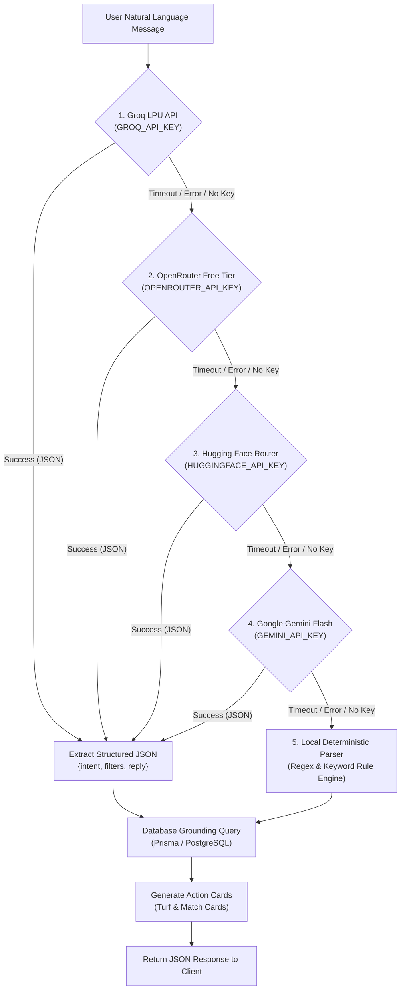

# SPORTZFY — Software Engineering Final Report Evidence Package
**Project Repository:** `swe_project`  
**Audit Date:** November 19, 2026  
**Auditor / Agent:** Antigravity (Google DeepMind)  
**Target Purpose:** Authoritative, fact-checked evidence package for the CUET Software Engineering Final Report writer.  
**Constraint Compliance:** Zero fabricated metrics, zero invented contributions, zero secrets/passwords, exact repository paths and line numbers for all architectural and empirical claims.

---

## 1. PROJECT IDENTITY AND SCOPE

### 1.1 Academic Identity & Course Metadata
Evidence from repository files establishes the following project identity attributes, including discrepancies across documents:

* **Project Title:**
  * Primary: **Sportzfy**
  * Subtitle / Tagline: *"Smart Turf Booking & Community Matchmaking Platform"* ([sportzfy-web/app/layout.tsx#L6-L10](file:///c:/Users/alifs/Downloads/swe_project/sportzfy-web/app/layout.tsx#L6-L10), [03feae4](file:///c:/Users/alifs/Downloads/swe_project/README.md))
* **Course Code Conflicts Across Documents:**
  * **`CSE-356`** (*Software Development - II* / *Software Engineering Sessional*):
    * Stated on Cover Page: `Sportzfy_Proposal_Report.pdf` (Page 1)
    * Stated in LaTeX Front Matter: [report/chapters/00_front_matter.tex#L8](file:///c:/Users/alifs/Downloads/swe_project/report/chapters/00_front_matter.tex#L8)
    * Stated in Acknowledgements: [report/chapters/10_acknowledgement.tex#L4](file:///c:/Users/alifs/Downloads/swe_project/report/chapters/10_acknowledgement.tex#L4)
    * Stated in Meeting Log: [report/appendices/appendix_d_meetings.tex#L30](file:///c:/Users/alifs/Downloads/swe_project/report/appendices/appendix_d_meetings.tex#L30)
  * **`CSE-355`** (*Software Engineering* / *Theory Course Code*):
    * Stated in Project Management Plan: [docs/01-project-management-plan.md#L8](file:///c:/Users/alifs/Downloads/swe_project/docs/01-project-management-plan.md#L8)
    * Stated in ML Pipeline: [ml/train_demand_model.py#L3](file:///c:/Users/alifs/Downloads/swe_project/ml/train_demand_model.py#L3)
    * Stated in ML Evaluation Report: [ml/model_evaluation_report.md#L2](file:///c:/Users/alifs/Downloads/swe_project/ml/model_evaluation_report.md#L2)
    * Stated in Pricing Engine: [sportzfy-web/lib/pricing.ts#L2](file:///c:/Users/alifs/Downloads/swe_project/sportzfy-web/lib/pricing.ts#L2)
    * Stated in Concurrency Script: [sportzfy-web/tests/verify-concurrency.ts#L5](file:///c:/Users/alifs/Downloads/swe_project/sportzfy-web/tests/verify-concurrency.ts#L5)
    * Stated in Deployment Guide: [DEPLOYMENT.md#L2](file:///c:/Users/alifs/Downloads/swe_project/DEPLOYMENT.md#L2)
  * *Conflict Assessment:* At CUET, CSE-355 is typically the 3rd-year 1st-semester Software Engineering theory course, while CSE-356 is the accompanying practical sessional (Software Development - II). The final report must align with the official cover page template specified by the department (see Section 10).
* **Credit Passed Requirement:**
  * Draft document [report/chapters/00_front_matter.tex#L10](file:///c:/Users/alifs/Downloads/swe_project/report/chapters/00_front_matter.tex#L10) historically stated `110` credits passed.
  * Verified CUET Undergraduate Syllabus standard for Level-3 Term-I (B22 batch) is `101.75` credits completed prior to the semester.
* **Supervisors Identified in Code & Documents:**
  * **Supervisor 1:** Mir Md. Saki Kowsar
    * *Designation Conflict:* Listed as `Prof. Mir Md. Saki Kowsar` in [proposal/Sportzfy_Architecture_Diagrams.md#L13](file:///c:/Users/alifs/Downloads/swe_project/proposal/Sportzfy_Architecture_Diagrams.md#L13) and [ml/model_evaluation_report.md#L3](file:///c:/Users/alifs/Downloads/swe_project/ml/model_evaluation_report.md#L3); officially listed as `Assistant Professor` in [report/chapters/00_front_matter.tex#L19](file:///c:/Users/alifs/Downloads/swe_project/report/chapters/00_front_matter.tex#L19) and Department faculty directory.
    * Department: Department of Computer Science & Engineering, CUET.
  * **Supervisor 2:** Md. Refaj Hossan
    * Designation: `Lecturer`, Department of Computer Science & Engineering, CUET ([report/chapters/00_front_matter.tex#L23](file:///c:/Users/alifs/Downloads/swe_project/report/chapters/00_front_matter.tex#L23)).

---

### 1.2 Team Members & Naming Discrepancies
The repository records three student team members, but uncovers naming variations between formal documents and developer handles:

| Student ID | Formal Name in LaTeX & Proposal | Name in Markdown / Scripts | Git Author / Commit Identity | Document Locations |
| :--- | :--- | :--- | :--- | :--- |
| **2204051** | `Mohammad Sakib Hasan` | `Sakib Alif` | `sakib <alifsakib1@gmail.com>`, `starboy1402` | [00_front_matter.tex#L12](file:///c:/Users/alifs/Downloads/swe_project/report/chapters/00_front_matter.tex#L12), [Sportzfy_Proposal_Report.pdf#p1](file:///c:/Users/alifs/Downloads/swe_project/Sportzfy_Proposal_Report.pdf), [pricing.ts#L3](file:///c:/Users/alifs/Downloads/swe_project/sportzfy-web/lib/pricing.ts#L3) |
| **2204040** | `Mahmudul Hasan` | `Mahmud Hasan` (Proposal) | None (0 commits) | [00_front_matter.tex#L14](file:///c:/Users/alifs/Downloads/swe_project/report/chapters/00_front_matter.tex#L14), [Sportzfy_Proposal_Report.pdf#p1](file:///c:/Users/alifs/Downloads/swe_project/Sportzfy_Proposal_Report.pdf) |
| **2204053** | `Ayan Barua` | `Ayan Barua` | None (0 commits) | [00_front_matter.tex#L16](file:///c:/Users/alifs/Downloads/swe_project/report/chapters/00_front_matter.tex#L16), [Sportzfy_Proposal_Report.pdf#p1](file:///c:/Users/alifs/Downloads/swe_project/Sportzfy_Proposal_Report.pdf) |

*Audit Note:* Git author `sakib <alifsakib1@gmail.com>` authored 30 of the 31 repository commits, with 1 commit merged from GitHub account `starboy1402` (display name `Mohammad Sakib Hasan`). Neither Mahmudul Hasan (2204040) nor Ayan Barua (2204053) appear in git author metadata.

---

### 1.3 Implementation Scope & Feature Classification
Based on a line-by-line inspection of `sportzfy-web/` (Next.js 16), `SPORTZFY-main/` (Expo/React Native), `ml/`, and `prisma/schema.prisma`:

#### A. Fully Implemented Web Features (`sportzfy-web/`)
1. **Multi-Role Authentication & Session Management:**
   * Custom HMAC-SHA256 signed session cookie (`sportzfy_session`) with 7-day TTL ([sportzfy-web/lib/auth.ts#L10-L45](file:///c:/Users/alifs/Downloads/swe_project/sportzfy-web/lib/auth.ts#L10-L45)).
   * Edge-compatible token verification via Web Crypto API ([sportzfy-web/lib/edge-auth.ts#L1-L60](file:///c:/Users/alifs/Downloads/swe_project/sportzfy-web/lib/edge-auth.ts#L1-L60)).
   * Edge route protection middleware guarding `/admin/*`, `/owner/*`, `/profile`, `/bookings`, `/checkout/*` ([sportzfy-web/middleware.ts#L1-L45](file:///c:/Users/alifs/Downloads/swe_project/sportzfy-web/middleware.ts#L1-L45)).
   * Role-based redirection upon login (`CUSTOMER` $\to$ `/`, `OWNER` $\to$ `/owner`, `ADMIN` $\to$ `/admin`) ([sportzfy-web/app/api/v1/auth/login/route.ts#L65-L85](file:///c:/Users/alifs/Downloads/swe_project/sportzfy-web/app/api/v1/auth/login/route.ts#L65-L85)).
   * One-click demo credential autofill on login page ([sportzfy-web/app/login/page.tsx#L38-L58](file:///c:/Users/alifs/Downloads/swe_project/sportzfy-web/app/login/page.tsx#L38-L58)).
2. **Turf Discovery & Catalog System:**
   * Multi-attribute catalog filtering (City, Format, Price Range, Search Term) ([sportzfy-web/app/api/v1/turfs/route.ts#L10-L65](file:///c:/Users/alifs/Downloads/swe_project/sportzfy-web/app/api/v1/turfs/route.ts#L10-L65)).
   * Categorized discovery shelves (*Top Rated*, *Budget Friendly*, *Floodlit Arenas*) ([sportzfy-web/app/api/v1/turfs/shelves/route.ts#L1-L115](file:///c:/Users/alifs/Downloads/swe_project/sportzfy-web/app/api/v1/turfs/shelves/route.ts#L1-L115)).
   * Detailed venue view with cover photo, amenities list, location coordinates, and 7-day slot availability timetable ([sportzfy-web/app/turfs/[id]/page.tsx#L1-L320](file:///c:/Users/alifs/Downloads/swe_project/sportzfy-web/app/turfs/[id]/page.tsx#L1-L320)).
3. **Atomic Slot Reservation & Booking Pipeline:**
   * 5-minute atomic lock acquisition backed by PostgreSQL `Serializable` transaction isolation ([sportzfy-web/app/api/v1/holds/route.ts#L50-L163](file:///c:/Users/alifs/Downloads/swe_project/sportzfy-web/app/api/v1/holds/route.ts#L50-L163)).
   * Overlap collision detection against confirmed bookings, active unexpired holds, and blocked maintenance intervals ([sportzfy-web/app/api/v1/holds/route.ts#L85-L125](file:///c:/Users/alifs/Downloads/swe_project/sportzfy-web/app/api/v1/holds/route.ts#L85-L125)).
   * Automatic hold expiration check upon checkout confirmation ([sportzfy-web/app/api/v1/bookings/route.ts#L60-L63](file:///c:/Users/alifs/Downloads/swe_project/sportzfy-web/app/api/v1/bookings/route.ts#L60-L63)).
   * Anti-hijacking hold ownership verification ([sportzfy-web/app/api/v1/bookings/route.ts#L55-L58](file:///c:/Users/alifs/Downloads/swe_project/sportzfy-web/app/api/v1/bookings/route.ts#L55-L58)).
   * Server-side QR code generation using `qrcode` library rendering scannable data URI ticket passes ([sportzfy-web/app/api/v1/bookings/route.ts#L127-L139](file:///c:/Users/alifs/Downloads/swe_project/sportzfy-web/app/api/v1/bookings/route.ts#L127-L139)).
   * Digital Pass Wallet with active/past passes and modal QR viewer ([sportzfy-web/app/bookings/page.tsx#L1-L190](file:///c:/Users/alifs/Downloads/swe_project/sportzfy-web/app/bookings/page.tsx#L1-L190)).
4. **Community Squad Matchmaking System:**
   * Squad Board listing public match recruitments with spot count and sport format ([sportzfy-web/app/matches/page.tsx#L1-L260](file:///c:/Users/alifs/Downloads/swe_project/sportzfy-web/app/matches/page.tsx#L1-L260)).
   * Create match post workflow with venue selection, sport format, cost per player, and required roles ([sportzfy-web/app/matches/new/page.tsx#L1-L240](file:///c:/Users/alifs/Downloads/swe_project/sportzfy-web/app/matches/new/page.tsx#L1-L240)).
   * Join request submission with position preference (Goalkeeper, Striker, Defender, Midfielder) ([sportzfy-web/app/api/v1/matches/[id]/join/route.ts#L1-L85](file:///c:/Users/alifs/Downloads/swe_project/sportzfy-web/app/api/v1/matches/[id]/join/route.ts#L1-L85)).
   * Captain decision workflow (Accept/Reject) with atomic decrement of `openSpots` and automatic transition to `FULL` ([sportzfy-web/app/api/v1/matches/[id]/requests/[requestId]/decision/route.ts#L1-L125](file:///c:/Users/alifs/Downloads/swe_project/sportzfy-web/app/api/v1/matches/[id]/requests/[requestId]/decision/route.ts#L1-L125)).
5. **Turf Owner Portal:**
   * Owner dashboard with revenue aggregation, active bookings counter, and venue occupancy stats ([sportzfy-web/app/owner/page.tsx#L1-L450](file:///c:/Users/alifs/Downloads/swe_project/sportzfy-web/app/owner/page.tsx#L1-L450)).
   * Venue listing onboarding and editing forms ([sportzfy-web/app/owner/turfs/new/page.tsx](file:///c:/Users/alifs/Downloads/swe_project/sportzfy-web/app/owner/turfs/new/page.tsx), [sportzfy-web/app/owner/turfs/[id]/edit/page.tsx](file:///c:/Users/alifs/Downloads/swe_project/sportzfy-web/app/owner/turfs/[id]/edit/page.tsx)).
   * Slot locker / schedule manager for weekly operating hours and ad-hoc maintenance blocks ([sportzfy-web/app/owner/schedule/page.tsx#L1-L420](file:///c:/Users/alifs/Downloads/swe_project/sportzfy-web/app/owner/schedule/page.tsx#L1-L420)).
   * One-click AI dynamic rate schedule synchronization to PostgreSQL database ([sportzfy-web/app/api/v1/owner/availability/route.ts#L70-L130](file:///c:/Users/alifs/Downloads/swe_project/sportzfy-web/app/api/v1/owner/availability/route.ts#L70-L130)).
   * Withdrawal request creation for owner earnings ([sportzfy-web/app/api/v1/owner/payouts/route.ts#L1-L90](file:///c:/Users/alifs/Downloads/swe_project/sportzfy-web/app/api/v1/owner/payouts/route.ts#L1-L90)).
6. **Platform Administration Portal:**
   * Platform-wide metrics (total GMV, approved venues, bookings, registered accounts) ([sportzfy-web/app/api/v1/admin/stats/route.ts#L1-L60](file:///c:/Users/alifs/Downloads/swe_project/sportzfy-web/app/api/v1/admin/stats/route.ts#L1-L60)).
   * Venue approval queue with `APPROVED` / `REJECTED` state transitions ([sportzfy-web/app/api/v1/admin/turfs/[id]/review/route.ts#L1-L55](file:///c:/Users/alifs/Downloads/swe_project/sportzfy-web/app/api/v1/admin/turfs/[id]/review/route.ts#L1-L55)).
   * Payout settlement queue with transaction reference recording and disbursement state update ([sportzfy-web/app/api/v1/admin/payouts/route.ts#L1-L90](file:///c:/Users/alifs/Downloads/swe_project/sportzfy-web/app/api/v1/admin/payouts/route.ts#L1-L90)).
7. **AI & ML Integration:**
   * Multi-provider AI Concierge API route with automatic cascade (Groq $\to$ OpenRouter $\to$ HuggingFace $\to$ Gemini $\to$ Local Regex) ([sportzfy-web/app/api/v1/ai/chat/route.ts#L300-L385](file:///c:/Users/alifs/Downloads/swe_project/sportzfy-web/app/api/v1/ai/chat/route.ts#L300-L385)).
   * Real database grounding for AI chat returning actionable turf and match cards ([sportzfy-web/app/api/v1/ai/chat/route.ts#L390-L480](file:///c:/Users/alifs/Downloads/swe_project/sportzfy-web/app/api/v1/ai/chat/route.ts#L390-L480)).
   * Random Forest dynamic pricing engine running in-process via serialized JSON trees with sub-millisecond execution ([sportzfy-web/lib/pricing.ts#L120-L245](file:///c:/Users/alifs/Downloads/swe_project/sportzfy-web/lib/pricing.ts#L120-L245)).

#### B. Implemented Mobile Features (`SPORTZFY-main/`)
* **Technology:** Standalone Expo 51.0.28 / React Native 0.74.5 project.
* **Screens Implemented (11 Screens):** Welcome, Login, Register, Explore (Home), TurfDetail, BookingModal, SquadBoard, MatchDetail, CreateMatch, Profile, OwnerDashboard.
* **CRITICAL ARCHITECTURAL FINDING:** The mobile codebase in `SPORTZFY-main/` is an **isolated UI prototype** powered exclusively by static mock datasets ([SPORTZFY-main/src/data/mockData.js](file:///c:/Users/alifs/Downloads/swe_project/SPORTZFY-main/src/data/mockData.js), [SPORTZFY-main/src/data/ownerMockData.js](file:///c:/Users/alifs/Downloads/swe_project/SPORTZFY-main/src/data/ownerMockData.js)). It makes **no HTTP network calls** to the Next.js API or Neon PostgreSQL database.
* **Scope Exclusion in Proposal:** Page 4 of `Sportzfy_Proposal_Report.pdf` explicitly excluded a native mobile client from the formal project deliverables, designating it as future exploratory work.

#### C. Prototype / Simulator Features
* **Checkout & Payment:** Simulated checkout drawer/page ([sportzfy-web/app/checkout/[holdId]/page.tsx](file:///c:/Users/alifs/Downloads/swe_project/sportzfy-web/app/checkout/[holdId]/page.tsx)). Generates mock transaction strings (`TXN${Date.now().toString().slice(-8)}`). Does not connect to live bKash, Nagad, Rocket, or SSLCommerz merchant gateways.
* **AI Concierge Local Fallback:** Rule-based regex parser that handles queries when cloud LLM API keys are unconfigured or fail ([sportzfy-web/app/api/v1/ai/chat/route.ts#L480-L650](file:///c:/Users/alifs/Downloads/swe_project/sportzfy-web/app/api/v1/ai/chat/route.ts#L480-L650)).

#### D. Proposed-Only Features (Documented in Proposals/Plans but Not in Code)
* Live MFS Merchant APIs (tokenized bKash Checkout URL, Nagad Direct PG, SSLCommerz session API).
* Automated Bank/MFS Payout Disbursement (disbursements are manually updated in DB).
* SMS Notification Gateway (BulkSMS BD, Twilio).
* Live Turn-by-Turn GPS Navigation / Interactive Leaflet Map routing.
* WebSocket / Socket.io bidirectional push channels for instantaneous seat changes (system uses client-side polling and re-renders).

---

### 1.4 Seed Data Inventory
The seed script [sportzfy-web/prisma/seed.ts](file:///c:/Users/alifs/Downloads/swe_project/sportzfy-web/prisma/seed.ts) (1,103 lines) populates the database with realistic Bangladeshi sports venue data:

* **Seeded User Accounts (6 Users):**
  1. `admin@sportzfy.com` (Role: `ADMIN`) — Platform Administrator
  2. `owner@sportzfy.com` (Role: `OWNER`) — Chattogram Turf Partner (owns Jaff Arena, Metro Sports)
  3. `owner2@sportzfy.com` (Role: `OWNER`) — Dhaka Turf Partner (owns Dhanmondi Turf, Banani Arena)
  4. `player@sportzfy.com` (Role: `CUSTOMER`) — Sakib Alif (Striker)
  5. `player2@sportzfy.com` (Role: `CUSTOMER`) — Tanvir Ahmed (Goalkeeper)
  6. `player3@sportzfy.com` (Role: `CUSTOMER`) — Rafid Hossain (Midfielder)
* **Seeded Turf Venues (20 Venues across 3 Divisions):**
  * **Chattogram (8 Venues):**
    1. Jaff Arena (Panchlaish) — ৳2,200/hr, 7v7, 6v6, 5v5
    2. Metro Sports Arena (Agrabad) — ৳2,000/hr, 7v7, 6v6
    3. Bay Turf (Patenga) — ৳1,800/hr, 6v6, 5v5
    4. Oxygen Sports Complex (Oxygen) — ৳1,600/hr, 5v5
    5. Agrabad Turf Zone (Agrabad) — ৳2,400/hr, 7v7
    6. Nasirabad Kickoff Arena (Nasirabad) — ৳2,100/hr, 6v6
    7. Halishahar Soccer Club (Halishahar) — ৳1,900/hr, 7v7
    8. Khulshi Sports Hub (Khulshi) — ৳2,500/hr, 7v7, 6v6
  * **Dhaka (8 Venues):**
    9. Dhanmondi Turf Zone (Dhanmondi) — ৳2,600/hr, 7v7
    10. Banani Football Arena (Banani) — ৳2,800/hr, 7v7
    11. Uttara Kickoff Club (Uttara) — ৳2,200/hr, 6v6
    12. Mirpur Futsal Ground (Mirpur) — ৳1,800/hr, 5v5
    13. Gulshan Turf Arena (Gulshan) — ৳3,000/hr, 7v7
    14. Bashundhara Sports Ground (Bashundhara) — ৳2,500/hr, 7v7
    15. Mohakhali Football Turf (Mohakhali) — ৳2,000/hr, 6v6
    16. Mohammadpur Arena (Mohammadpur) — ৳1,900/hr, 5v5
  * **Sylhet (4 Venues):**
    17. Sylhet Royal Turf (Upashahar) — ৳2,000/hr, 7v7
    18. Zindabazar Sports Arena (Zindabazar) — ৳1,800/hr, 6v6
    19. Shahjalal Futsal Ground (Shibbari) — ৳1,600/hr, 5v5
    20. Amberkhana Turf Club (Amberkhana) — ৳1,700/hr, 5v5
* **Seeded Supporting Entities:**
  * 140 Availability Rules (7 rules per turf covering Monday through Sunday, 16:00 to 25:00/01:00 AM).
  * 12 Match Posts (open spots across positions with split cost pricing).
  * 15 Historical Bookings & Payment Attempts with generated QR codes.
  * 24 Customer Reviews with ratings (4.2 to 5.0 stars) and feedback text.
  * 4 Owner Payout Requests (Pending and Disbursed states).

---

## 2. DEVELOPMENT HISTORY

The chronological development trajectory is reconstructed directly from repository commits (zero invented meeting minutes, hours, or sprint breakdowns):

| Date | Commit Hash | Author | Verifiable Milestone & Implementation Scope |
| :--- | :--- | :--- | :--- |
| **2026-09-04** | `574af9c` | `sakib` | Initialized repository baseline, research evidence, and SRS draft. |
| **2026-09-04** | `97cbfbc` | `sakib` | Scaffolded `sportzfy-web` with Next.js 16, TypeScript 5, Tailwind CSS v4, Lucide, Prisma. |
| **2026-09-04** | `682e348` | `sakib` | Implemented Field Energy design system tokens, Bebas Neue + Barlow typography, kinetic styles. |
| **2026-09-04** | `6f7ec43` | `sakib` | Defined Prisma schema models (`User`, `Turf`, `Hold`, `Booking`), seeded 20 Bangladesh venues. |
| **2026-09-04** | `ce2347b` | `sakib` | Built REST endpoints for turf catalog, live availability, atomic holds, and QR ticket generation. |
| **2026-09-04** | `9fe895c` | `sakib` | Built homepage UI, live slot timetable selector, bKash checkout simulator, digital pass wallet. |
| **2026-09-04** | `8a9e6a4` | `sakib` | Implemented Turf Owner dashboard, slot locker, venue listing onboarding, dynamic pricing view. |
| **2026-09-04** | `d3a72ef` | `sakib` | Developed Squad Matchmaking board, goalkeeper recruitment, join requests, captain roster room. |
| **2026-09-04** | `ebc8d47` | `sakib` | Implemented Admin governance portal, TC-HOLD-01 concurrency script, scikit-learn ML pipeline. |
| **2026-09-04** | `c750af0` | `sakib` | Implemented complete RBAC authentication with session cookies and Edge route guards. |
| **2026-09-04** | `70a83d6` | `sakib` | Added initial unit/integration test suites and edge case validation for slot validation. |
| **2026-09-04** | `cdd9884` | `sakib` | Migrated database connection to production Neon Serverless PostgreSQL with connection pooling. |
| **2026-09-04** | `96805be` | `sakib` | Added interactive match entry pass modal with scannable QR code and full match details. |
| **2026-09-04** | `60ad387` | `sakib` | Added login and registration pages with role-based redirection and 1-click demo logins. |
| **2026-09-08** | `fc708c5` | `sakib` | Integrated serialized Random Forest JSON trees into TypeScript runtime with safety clamps. |
| **2026-09-09** | `9fb0af5` | `sakib` | Implemented HMAC-SHA256 session token encoding with Edge Web Crypto verification. |
| **2026-09-09** | `af3a9b0` | `sakib` | Added booking history wallet page and Foodpanda-style discovery shelves component. |
| **2026-11-03** | `b3d492c` | `sakib` | Updated core API route error handlers and refined Prisma schema relation cascades. |
| **2026-11-03** | `80f7a12` | `sakib` | Added AI chat assistant API route (`/api/v1/ai/chat`) and floating drawer UI component. |
| **2026-11-04** | `f2d01f3` | `sakib` | Added multi-provider AI fallback cascade, database card retrieval, and RBAC security tests. |
| **2026-11-11** | `03feae4` | `starboy1402` | Added comprehensive project README documentation ([PR #1](https://github.com/starboy1402/swe_project/pull/1)). |
| **2026-11-16** | `42489ae` | `sakib` | Added launch video assets and documentation for bragging skill. |
| **2026-11-18** | `72d8075` | `sakib` | Added automated screenshot capture utilities and report test execution logging. |

*Information Needed from Student Team:* Because Git author metadata does not record commits from Mahmudul Hasan (2204040) or Ayan Barua (2204053), the student team must provide the specific breakdown of tasks, requirements analysis, documentation, and testing authored by each individual member.

---

## 3. ARCHITECTURE AND IMPLEMENTATION MAP

### 3.1 Technology Stack Architecture
* **Frontend Framework:** Next.js 16.3.4 (App Router), React 19.2.8, TypeScript 5.
* **Styling & Icons:** Tailwind CSS v4, Lucide React 1.40.0, Canvas Confetti 1.9.4.
* **Backend API:** Next.js Route Handlers (`app/api/v1/*`), Node.js runtime / Vercel Serverless Functions.
* **ORM & Database:** Prisma 6.19.3 ORM connecting to Neon Serverless PostgreSQL (`ep-quiet-star-a19t9u6x-pooler.ap-southeast-1.aws.neon.tech`).
* **Authentication:** Custom session cookies signed with HMAC-SHA256, verified via Node.js `crypto` or Edge `crypto.subtle`.
* **Mobile Prototype:** Expo 51.0.28, React Native 0.74.5, React Navigation (Static mock client).
* **ML Inference:** Serialized Decision Trees (`lib/rf_trees.json`) evaluated directly in TypeScript (< 0.1ms latency).
* **Cloud Hosting:** Vercel Serverless Platform (`sportzfy-zeta.vercel.app`).

---

### 3.2 User Journey Implementation Traceability

| User Journey | UI Page / Component | Route Handler / API | Helper / Service | Prisma Models | Automated Test Evidence |
| :--- | :--- | :--- | :--- | :--- | :--- |
| **1. Player Booking & QR Pass** | [app/turfs/[id]/page.tsx](file:///c:/Users/alifs/Downloads/swe_project/sportzfy-web/app/turfs/[id]/page.tsx), [app/checkout/[holdId]/page.tsx](file:///c:/Users/alifs/Downloads/swe_project/sportzfy-web/app/checkout/[holdId]/page.tsx), [app/bookings/page.tsx](file:///c:/Users/alifs/Downloads/swe_project/sportzfy-web/app/bookings/page.tsx) | [app/api/v1/holds/route.ts](file:///c:/Users/alifs/Downloads/swe_project/sportzfy-web/app/api/v1/holds/route.ts), [app/api/v1/bookings/route.ts](file:///c:/Users/alifs/Downloads/swe_project/sportzfy-web/app/api/v1/bookings/route.ts) | [lib/pricing.ts](file:///c:/Users/alifs/Downloads/swe_project/sportzfy-web/lib/pricing.ts), [lib/auth.ts](file:///c:/Users/alifs/Downloads/swe_project/sportzfy-web/lib/auth.ts) | `Turf`, `Hold`, `Booking`, `PaymentAttempt` | `TC-SLOT-01` to `05`, `TC-PRICE-01` to `04`, `TC-BOOK-01` to `03` |
| **2. Owner Management & Schedule** | [app/owner/page.tsx](file:///c:/Users/alifs/Downloads/swe_project/sportzfy-web/app/owner/page.tsx), [app/owner/schedule/page.tsx](file:///c:/Users/alifs/Downloads/swe_project/sportzfy-web/app/owner/schedule/page.tsx) | [app/api/v1/owner/stats/route.ts](file:///c:/Users/alifs/Downloads/swe_project/sportzfy-web/app/api/v1/owner/stats/route.ts), [app/api/v1/owner/availability/route.ts](file:///c:/Users/alifs/Downloads/swe_project/sportzfy-web/app/api/v1/owner/availability/route.ts) | [lib/pricing.ts](file:///c:/Users/alifs/Downloads/swe_project/sportzfy-web/lib/pricing.ts) | `Turf`, `AvailabilityRule`, `BlockedInterval`, `PayoutRequest` | `TC-OWNER-01`, `TC-OWNER-02`, `TC-AI-PRICE-02` |
| **3. Admin Governance & Review** | [app/admin/page.tsx](file:///c:/Users/alifs/Downloads/swe_project/sportzfy-web/app/admin/page.tsx) | [app/api/v1/admin/stats/route.ts](file:///c:/Users/alifs/Downloads/swe_project/sportzfy-web/app/api/v1/admin/stats/route.ts), [app/api/v1/admin/turfs/[id]/review/route.ts](file:///c:/Users/alifs/Downloads/swe_project/sportzfy-web/app/api/v1/admin/turfs/[id]/review/route.ts), [app/api/v1/admin/payouts/route.ts](file:///c:/Users/alifs/Downloads/swe_project/sportzfy-web/app/api/v1/admin/payouts/route.ts) | [lib/auth.ts](file:///c:/Users/alifs/Downloads/swe_project/sportzfy-web/lib/auth.ts) | `Turf`, `PayoutRequest`, `Booking`, `User` | `TC-RBAC-01`, `TC-PAYOUT-01` |
| **4. Squad Matchmaking & Recruitment** | [app/matches/page.tsx](file:///c:/Users/alifs/Downloads/swe_project/sportzfy-web/app/matches/page.tsx), [app/matches/[id]/page.tsx](file:///c:/Users/alifs/Downloads/swe_project/sportzfy-web/app/matches/[id]/page.tsx) | [app/api/v1/matches/route.ts](file:///c:/Users/alifs/Downloads/swe_project/sportzfy-web/app/api/v1/matches/route.ts), [app/api/v1/matches/[id]/join/route.ts](file:///c:/Users/alifs/Downloads/swe_project/sportzfy-web/app/api/v1/matches/[id]/join/route.ts), [app/api/v1/matches/[id]/requests/[requestId]/decision/route.ts](file:///c:/Users/alifs/Downloads/swe_project/sportzfy-web/app/api/v1/matches/[id]/requests/[requestId]/decision/route.ts) | [lib/auth.ts](file:///c:/Users/alifs/Downloads/swe_project/sportzfy-web/lib/auth.ts) | `MatchPost`, `JoinRequest`, `User`, `Turf` | `TC-MATCH-01`, `TC-MATCH-02`, `TC-MATCH-03` |
| **5. AI Concierge Assistant** | [components/ai-chat-drawer.tsx](file:///c:/Users/alifs/Downloads/swe_project/sportzfy-web/components/ai-chat-drawer.tsx) | [app/api/v1/ai/chat/route.ts](file:///c:/Users/alifs/Downloads/swe_project/sportzfy-web/app/api/v1/ai/chat/route.ts) | Multi-provider LLM cascade + Local Regex | `Turf`, `MatchPost`, `Profile` | `TC-AI-CHAT-01`, `TC-AI-CHAT-02` |
| **6. ML Dynamic Pricing Engine** | [app/owner/schedule/page.tsx](file:///c:/Users/alifs/Downloads/swe_project/sportzfy-web/app/owner/schedule/page.tsx), [app/turfs/[id]/page.tsx](file:///c:/Users/alifs/Downloads/swe_project/sportzfy-web/app/turfs/[id]/page.tsx) | [app/api/v1/holds/route.ts#L78-L84](file:///c:/Users/alifs/Downloads/swe_project/sportzfy-web/app/api/v1/holds/route.ts#L78-L84) | [lib/pricing.ts#L120-L245](file:///c:/Users/alifs/Downloads/swe_project/sportzfy-web/lib/pricing.ts#L120-L245) | `AvailabilityRule`, `Hold`, `Booking` | `TC-ML-PRICE-01` to `04`, `TC-AI-PRICE-01` |

---

### 3.3 Architecture Diagram vs Implementation Discrepancies
Auditing the existing diagram files ([report/images/architecture_diagram.png](file:///c:/Users/alifs/Downloads/swe_project/report/images/architecture_diagram.png), [report/images/cicd_pipeline.png](file:///c:/Users/alifs/Downloads/swe_project/report/images/cicd_pipeline.png), [Sportzfy_Architecture_Diagrams.md](file:///c:/Users/alifs/Downloads/swe_project/Sportzfy_Architecture_Diagrams.md)) against codebase reveals the following material mismatches:

1. **CI/CD Pipeline Diagram Mismatch:**
   * Diagram `cicd_pipeline.png` depicts a multi-stage GitHub Actions workflow (*Lint $\to$ Unit Tests $\to$ Integration Tests $\to$ Build $\to$ Vercel Deploy*).
   * **Reality:** Directory `.github/workflows/` **does not exist** in the repository. Vercel deploys directly via GitHub webhook triggers using `prisma generate && next build`. Tests are not automatically executed prior to production deployment.
2. **Payment Gateway Architecture Mismatch:**
   * Architecture diagrams illustrate external HTTP communication with bKash Merchant API, Nagad PG, and SSLCommerz.
   * **Reality:** Payment execution is handled completely internally by an in-process checkout simulator in [sportzfy-web/app/api/v1/bookings/route.ts#L111-L121](file:///c:/Users/alifs/Downloads/swe_project/sportzfy-web/app/api/v1/bookings/route.ts#L111-L121). No third-party financial API endpoints are called.
3. **Database Table Count Mismatch:**
   * Early proposal and architecture documents cited between 8 and 10 database tables.
   * **Reality:** The production schema ([sportzfy-web/prisma/schema.prisma](file:///c:/Users/alifs/Downloads/swe_project/sportzfy-web/prisma/schema.prisma)) defines **13 models**: `User`, `Profile`, `Turf`, `TurfImage`, `AvailabilityRule`, `BlockedInterval`, `Hold`, `Booking`, `PaymentAttempt`, `Review`, `MatchPost`, `JoinRequest`, and `PayoutRequest`. (Enums: 0, Prisma enums were removed in favor of string literals for SQLite/PostgreSQL cross-compatibility).
4. **Mobile App Connectivity Mismatch:**
   * Component diagrams show the React Native Mobile App communicating with the Next.js `/api/v1` backend.
   * **Reality:** `SPORTZFY-main/` uses static mock data files and has zero network fetch calls to the backend API.

---

### 3.4 Implemented Booking Hold, Expiry, Overlap, and Confirmation Flow
The exact booking lifecycle implemented in code executes through these stages:

1. **Parameter Validation:**
   * `POST /api/v1/holds` receives `{ turfId, startTime, endTime }`.
   * [lib/pricing.ts#validateSlotTimes](file:///c:/Users/alifs/Downloads/swe_project/sportzfy-web/lib/pricing.ts#L36-L70) validates:
     * `startTime >= now` (rejects with `SLOT_IN_PAST`).
     * `startTime <= now + 14 days` (rejects with `SLOT_TOO_FAR`).
     * `endTime > startTime` (rejects with `INVALID_INTERVAL`).
     * `duration <= 4 hours` (rejects with `INVALID_DURATION`).
2. **Session Guard:** Requires valid `sportzfy_session` cookie; returns 401 if unauthenticated.
3. **Atomic Serializable Transaction:**
   * Opens `prisma.$transaction` with `isolationLevel: Prisma.TransactionIsolationLevel.Serializable` ([sportzfy-web/app/api/v1/holds/route.ts#L161-L163](file:///c:/Users/alifs/Downloads/swe_project/sportzfy-web/app/api/v1/holds/route.ts#L161-L163)).
   * Computes 4-week historical booking density for ML feature input.
   * Evaluates Random Forest dynamic price quote.
   * **Conflict Checks:**
     1. `Booking`: Overlapping interval where `status == "CONFIRMED"` $\to$ throws `SLOT_ALREADY_BOOKED` (HTTP 409).
     2. `Hold`: Overlapping interval where `status == "ACTIVE"` and `expiresAt > now` $\to$ throws `SLOT_HELD_BY_ANOTHER` (HTTP 409).
     3. `BlockedInterval`: Overlapping interval $\to$ throws `SLOT_BLOCKED` (HTTP 409).
   * **Hold Creation:** Writes `Hold` record with `expiresAt = now + 5 minutes (300,000ms)`, `status = "ACTIVE"`, returning `hold.id`.
4. **Simulated Payment & Checkout:**
   * Player navigates to `/checkout/[holdId]`.
   * Player selects payment method (`BKASH`, `NAGAD`, `ROCKET`, `CARD`) and enters phone number.
   * Triggers `POST /api/v1/bookings` with `{ holdId, paymentMethod, accountNumber }`.
5. **Confirmation & Anti-Hijack Transaction:**
   * Queries `Hold` record inside `prisma.$transaction`:
     * If `hold == null` $\to$ throws `HOLD_NOT_FOUND` (HTTP 404).
     * If `hold.userId !== currentUser.id && currentUser.role !== "ADMIN"` $\to$ throws `UNAUTHORIZED_HOLD_ACCESS` (HTTP 403).
     * If `hold.status !== "ACTIVE" || hold.expiresAt <= now` $\to$ throws `HOLD_EXPIRED` (HTTP 410).
   * Generates CSPRNG reference code: `SPZ-2026-${timePart}-${randHex}`.
   * Creates `Booking` record with `status: "CONFIRMED"`.
   * Updates `Hold` status to `"CONSUMED"`.
   * Creates `PaymentAttempt` with `status: "SUCCEEDED"`.
6. **QR Ticket Emission:**
   * Encodes ticket payload `{ ref, turf, time, player, status: "VERIFIED" }` into scannable PNG data URL via `QRCode.toDataURL` ([sportzfy-web/app/api/v1/bookings/route.ts#L127-L139](file:///c:/Users/alifs/Downloads/swe_project/sportzfy-web/app/api/v1/bookings/route.ts#L127-L139)).
   * Client receives booking details and QR pass; displayed in wallet at `/bookings`.

---

## 4. PAYMENT AND AI FACT CHECK

### 4.1 Payment Simulator Verification
* **Real Financial Gateway Status:** **0% Implemented**. There is no network communication with bKash Tokenized Checkout APIs, Nagad Merchant APIs, Rocket APIs, or SSLCommerz payment sessions.
* **Checkout Simulator Implementation:**
  * UI Drawer: [sportzfy-web/app/checkout/[holdId]/page.tsx](file:///c:/Users/alifs/Downloads/swe_project/sportzfy-web/app/checkout/[holdId]/page.tsx) renders simulated radio cards for bKash, Nagad, Rocket, and Visa/Mastercard.
  * API Handling: [sportzfy-web/app/api/v1/bookings/route.ts#L7-L123](file:///c:/Users/alifs/Downloads/swe_project/sportzfy-web/app/api/v1/bookings/route.ts#L7-L123) receives the selected method and phone number.
  * Transaction ID Generation: `const generatedTxId = transactionId || "TXN" + Date.now().toString().slice(-8);` ([sportzfy-web/app/api/v1/bookings/route.ts#L68](file:///c:/Users/alifs/Downloads/swe_project/sportzfy-web/app/api/v1/bookings/route.ts#L68)).
  * Database Storage:
    * `Booking.paymentMethod` stores the string literal (`"BKASH"`, `"NAGAD"`, `"ROCKET"`, `"CARD"`).
    * `Booking.transactionId` stores the simulated transaction ID string.
    * `Booking.status` is directly set to `"CONFIRMED"`.
    * `PaymentAttempt` record is created with `status: "SUCCEEDED"`.
* **Refunds & Owner Payouts:**
  * Payout requests are initiated by owners via `POST /api/v1/owner/payouts` (`status = "PENDING"`).
  * Admins approve payouts via `POST /api/v1/admin/payouts` and input a manual transaction reference. No automated bank or MFS disbursement API is called.

---

### 4.2 AI Concierge Architecture & Execution Flow
The AI Concierge route in [sportzfy-web/app/api/v1/ai/chat/route.ts](file:///c:/Users/alifs/Downloads/swe_project/sportzfy-web/app/api/v1/ai/chat/route.ts) implements an ultra-resilient multi-tier fallback architecture:



#### Detailed Provider Configuration & Conditions:
1. **Tier 1 — Groq LPU Engine:**
   * Trigger Condition: `process.env.GROQ_API_KEY` is present.
   * Endpoint: `https://api.groq.com/openai/v1/chat/completions`.
   * Model: `qwen/qwen3.8-27b` (temperature: 0.2, timeout: 8,000ms AbortController).
2. **Tier 2 — OpenRouter Free Tier:**
   * Trigger Condition: Groq fails or no key, and `process.env.OPENROUTER_API_KEY` is present.
   * Endpoint: `https://openrouter.ai/api/v1/chat/completions`.
   * Candidate Models: `nvidia/nemotron-3-ultra-550b-a55b:free`, `dots-studio/dots-3-note-preview:free`, `meta-llama/llama-3.2-3b-instruct:free`, `inclusionai/ling-3.2-flash:free`.
3. **Tier 3 — Hugging Face Router:**
   * Trigger Condition: OpenRouter fails or no key, and `process.env.HUGGINGFACE_API_KEY` is present.
   * Endpoint: `https://router.huggingface.co/v1/chat/completions`.
   * Candidate Models: `Qwen/Qwen3.8-27B`, `meta-llama/Llama-3.1-8B-Instruct`, `Qwen/Qwen3.5-9B`.
4. **Tier 4 — Google Gemini Engine:**
   * Trigger Condition: Hugging Face fails or no key, and `process.env.GEMINI_API_KEY` is present.
   * Endpoint: `https://generativelanguage.googleapis.com/v1beta/models/{model}:generateContent`.
   * Candidate Models: `gemini-1.5-flash`, `gemini-2.0-flash-exp`, `gemini-3.5-flash`.
5. **Tier 5 — Local Deterministic Rule-Based Fallback:**
   * Trigger Condition: All external LLM engines fail, timeout, or no API keys exist in `.env`.
   * Implementation: Regular expressions match intent keywords (`"turf"`, `"pitch"`, `"field"`, `"match"`, `"squad"`, `"goalkeeper"`, `"striker"`, `"chattogram"`, `"dhaka"`).

#### Database Grounding Verification:
* The AI engine does **not** hallucinate venues or matches.
* In [sportzfy-web/app/api/v1/ai/chat/route.ts#L390-L475](file:///c:/Users/alifs/Downloads/swe_project/sportzfy-web/app/api/v1/ai/chat/route.ts#L390-L475), the extracted filters are passed to Prisma:
  * For `TURF_SEARCH`: queries `prisma.turf.findMany({ where: { status: "APPROVED", city, ... } })`.
  * For `MATCH_SEARCH`: queries `prisma.matchPost.findMany({ where: { status: "OPEN", openSpots: { gt: 0 } } })`.
* Returns structured `ChatActionCard[]` containing real venue names, cover image URLs, prices, and direct booking links (`actionUrl: "/turfs/{id}"` or `"/matches/{id}"`).

---

### 4.3 ML Dynamic Pricing Engine Fact Check
* **Model Pipeline Source File:** [ml/train_demand_model.py](file:///c:/Users/alifs/Downloads/swe_project/ml/train_demand_model.py)
* **Algorithm:** `RandomForestRegressor` from `scikit-learn` (`n_estimators=100`, `max_depth=8`, `min_samples_split=4`, `random_state=42`).
* **Dataset Source:** **100% Synthetic Data**.
  * Generated via `generate_synthetic_bangladesh_turf_dataset(n_samples=6000, random_state=42)` ([ml/train_demand_model.py#L32-L90](file:///c:/Users/alifs/Downloads/swe_project/ml/train_demand_model.py#L32-L90)).
  * Generates 6,000 synthetic observations across 60 days.
  * Features (8 inputs): `day_of_week`, `is_weekend`, `hour_of_day`, `is_prime_hour`, `base_price`, `venue_rating`, `historical_density_4w`, `is_rainy`.
  * Ground truth demand probability function in script:
    $$	ext{Demand} = 	ext{clip}\left(0.28 + 0.28 \cdot 	ext{is\_weekend} + 0.25 \cdot 	ext{is\_prime\_hour} + 0.16 \cdot 	ext{density} + 0.06 \cdot (	ext{rating}-4.5) - 0.22 \cdot 	ext{is\_rainy} + \dots + \mathcal{N}(0, 0.02), 0.08, 0.98
ight)$$
* **Train / Test Partitioning:**
  * **Strict Chronological Temporal Split** (zero data leakage):
    * Training Set: Days 1 to 45 (75%, ~4,500 observations).
    * Test Set: Days 46 to 60 (25%, ~1,500 observations evaluated strictly out-of-time).
* **Documented vs Reproduced Evaluation Metrics:**
  * Documented in [ml/model_evaluation_report.md#L25-L37](file:///c:/Users/alifs/Downloads/swe_project/ml/model_evaluation_report.md#L25-L37):
    * Baseline 1 (Historical Mean): $	ext{MAE} = 0.1680$, $	ext{RMSE} = 0.1970$, $R^2 = -0.0011$
    * Baseline 2 (Static Rules): $	ext{MAE} = 0.0629$, $	ext{RMSE} = 0.0771$, $R^2 = 0.8465$
    * Sportzfy Random Forest: $\mathbf{MAE = 0.0167}$, $\mathbf{RMSE = 0.0210}$, $\mathbf{R^2 = 0.9887}$
  * *Important Academic Reality Check:* The very high $R^2$ ($0.9887$) and low MAE ($0.0167$) occur because the machine learning model was trained to approximate the deterministic algebraic formula written in the generator script with minimal Gaussian noise ($\sigma = 0.02$). The report must be candid that these metrics demonstrate architectural pipeline viability on synthetic data rather than empirical convergence on wild human behavior.
* **Exported Model Artifact:**
  * Serialized to [sportzfy-web/lib/rf_trees.json](file:///c:/Users/alifs/Downloads/swe_project/sportzfy-web/lib/rf_trees.json) (430.7 KB JSON containing 100 decision trees).
* **Runtime In-Process TypeScript Inference:**
  * Implemented in [sportzfy-web/lib/pricing.ts#L120-L245](file:///c:/Users/alifs/Downloads/swe_project/sportzfy-web/lib/pricing.ts#L120-L245).
  * Evaluates trees in a compact in-process loop without external Python process calls or network requests, taking $< 0.1$ms.
* **Strict Price Safety Clamps:**
  * Configured in [sportzfy-web/lib/pricing.ts#L13-L16](file:///c:/Users/alifs/Downloads/swe_project/sportzfy-web/lib/pricing.ts#L13-L16):
    * Minimum Multiplier Floor: **`0.80x`** (maximum 20% discount).
    * Maximum Multiplier Ceiling: **`1.30x`** (maximum 30% surge).
    * Clamping formula:
      $$	ext{Price}_{	ext{final}} = 	ext{round}\left(	ext{clamp}\left(	ext{Price}_{	ext{base}} 	imes 	ext{Multiplier}_{	ext{raw}}, 0.80 	imes 	ext{Price}_{	ext{base}}, 1.30 	imes 	ext{Price}_{	ext{base}}
ight) / 50
ight) 	imes 50$$

---

## 5. REQUIREMENTS AND DIAGRAM INPUT

### 5.1 Implemented Functional Requirements Inventory

| Req ID | Requirement Statement | Primary Actor | Verifiable Implementation Evidence (Path & Lines) |
| :--- | :--- | :--- | :--- |
| **FR-AUTH-01** | User registration with role selection (Player vs Owner) and bcrypt password hashing. | Guest | [app/api/v1/auth/register/route.ts#L1-L60](file:///c:/Users/alifs/Downloads/swe_project/sportzfy-web/app/api/v1/auth/register/route.ts#L1-L60), [tests/auth.test.ts#L106-L118](file:///c:/Users/alifs/Downloads/swe_project/sportzfy-web/tests/auth.test.ts#L106-L118) |
| **FR-AUTH-02** | User login with HMAC-signed session cookies and role-aware portal redirection. | User | [app/api/v1/auth/login/route.ts#L1-L90](file:///c:/Users/alifs/Downloads/swe_project/sportzfy-web/app/api/v1/auth/login/route.ts#L1-L90), [lib/auth.ts#L10-L45](file:///c:/Users/alifs/Downloads/swe_project/sportzfy-web/lib/auth.ts#L10-L45) |
| **FR-AUTH-03** | Edge-level URL route guards rejecting unauthorized access to protected roles. | Guest / User | [middleware.ts#L1-L45](file:///c:/Users/alifs/Downloads/swe_project/sportzfy-web/middleware.ts#L1-L45), [lib/edge-auth.ts#L1-L60](file:///c:/Users/alifs/Downloads/swe_project/sportzfy-web/lib/edge-auth.ts#L1-L60) |
| **FR-TURF-01** | Search and filter turf catalog by city, pitch format, price ceiling, and name. | Player | [app/api/v1/turfs/route.ts#L10-L65](file:///c:/Users/alifs/Downloads/swe_project/sportzfy-web/app/api/v1/turfs/route.ts#L10-L65), [tests/rbac-security.test.ts#L43-L72](file:///c:/Users/alifs/Downloads/swe_project/sportzfy-web/tests/rbac-security.test.ts#L43-L72) |
| **FR-TURF-02** | Display categorized discovery shelves (Top Rated, Budget Friendly, Floodlit). | Player | [app/api/v1/turfs/shelves/route.ts#L1-L115](file:///c:/Users/alifs/Downloads/swe_project/sportzfy-web/app/api/v1/turfs/shelves/route.ts#L1-L115) |
| **FR-TURF-03** | View 7-day venue timetable with slot availability, pricing, and blocked status. | Player | [app/api/v1/turfs/[id]/availability/route.ts#L1-L140](file:///c:/Users/alifs/Downloads/swe_project/sportzfy-web/app/api/v1/turfs/[id]/availability/route.ts#L1-L140) |
| **FR-HOLD-01** | Acquire 5-minute atomic reservation hold with concurrency collision prevention. | Player | [app/api/v1/holds/route.ts#L50-L163](file:///c:/Users/alifs/Downloads/swe_project/sportzfy-web/app/api/v1/holds/route.ts#L50-L163), [tests/verify-concurrency.ts#L59-L103](file:///c:/Users/alifs/Downloads/swe_project/sportzfy-web/tests/verify-concurrency.ts#L59-L103) |
| **FR-BOOK-01** | Confirm booking against active hold, simulate payment, and generate QR entry pass. | Player | [app/api/v1/bookings/route.ts#L44-L149](file:///c:/Users/alifs/Downloads/swe_project/sportzfy-web/app/api/v1/bookings/route.ts#L44-L149), [tests/booking-and-roster.test.ts#L5-L48](file:///c:/Users/alifs/Downloads/swe_project/sportzfy-web/tests/booking-and-roster.test.ts#L5-L48) |
| **FR-BOOK-02** | Reject expired holds and prevent unauthorized hold hijacking during confirmation. | System | [app/api/v1/bookings/route.ts#L55-L63](file:///c:/Users/alifs/Downloads/swe_project/sportzfy-web/app/api/v1/bookings/route.ts#L55-L63), [tests/booking-and-roster.test.ts#L203-L230](file:///c:/Users/alifs/Downloads/swe_project/sportzfy-web/tests/booking-and-roster.test.ts#L203-L230) |
| **FR-SQUAD-01**| Post community matchmaking request specifying format, open spots, and split fee. | Player | [app/api/v1/matches/route.ts#L45-L110](file:///c:/Users/alifs/Downloads/swe_project/sportzfy-web/app/api/v1/matches/route.ts#L45-L110), [tests/booking-and-roster.test.ts#L50-L81](file:///c:/Users/alifs/Downloads/swe_project/sportzfy-web/tests/booking-and-roster.test.ts#L50-L81) |
| **FR-SQUAD-02**| Submit join request for open squad spot with preferred player position. | Player | [app/api/v1/matches/[id]/join/route.ts#L1-L85](file:///c:/Users/alifs/Downloads/swe_project/sportzfy-web/app/api/v1/matches/[id]/join/route.ts#L1-L85) |
| **FR-SQUAD-03**| Captain decision workflow: accept/reject join request with atomic roster update. | Player (Host)| [app/api/v1/matches/[id]/requests/[requestId]/decision/route.ts#L1-L125](file:///c:/Users/alifs/Downloads/swe_project/sportzfy-web/app/api/v1/matches/[id]/requests/[requestId]/decision/route.ts#L1-L125), [tests/booking-and-roster.test.ts#L83-L201](file:///c:/Users/alifs/Downloads/swe_project/sportzfy-web/tests/booking-and-roster.test.ts#L83-L201) |
| **FR-OWNER-01**| Turf listing creation and profile update with amenities and operating hours. | Owner | [app/api/v1/owner/turfs/route.ts#L1-L80](file:///c:/Users/alifs/Downloads/swe_project/sportzfy-web/app/api/v1/owner/turfs/route.ts#L1-L80), [app/api/v1/owner/turfs/[id]/route.ts#L1-L110](file:///c:/Users/alifs/Downloads/swe_project/sportzfy-web/app/api/v1/owner/turfs/[id]/route.ts#L1-L110) |
| **FR-OWNER-02**| Schedule locker: block ad-hoc slot intervals for walk-in players or maintenance. | Owner | [app/api/v1/owner/blocked-intervals/route.ts#L1-L120](file:///c:/Users/alifs/Downloads/swe_project/sportzfy-web/app/api/v1/owner/blocked-intervals/route.ts#L1-L120) |
| **FR-OWNER-03**| One-click AI Dynamic Pricing schedule calculation and database synchronization. | Owner | [app/api/v1/owner/availability/route.ts#L70-L130](file:///c:/Users/alifs/Downloads/swe_project/sportzfy-web/app/api/v1/owner/availability/route.ts#L70-L130), [tests/rbac-security.test.ts#L299-L358](file:///c:/Users/alifs/Downloads/swe_project/sportzfy-web/tests/rbac-security.test.ts#L299-L358) |
| **FR-OWNER-04**| Submit earnings withdrawal request with mobile financial service details. | Owner | [app/api/v1/owner/payouts/route.ts#L1-L90](file:///c:/Users/alifs/Downloads/swe_project/sportzfy-web/app/api/v1/owner/payouts/route.ts#L1-L90) |
| **FR-ADMIN-01**| Review and approve or reject newly onboarded turf venue applications. | Admin | [app/api/v1/admin/turfs/[id]/review/route.ts#L1-L55](file:///c:/Users/alifs/Downloads/swe_project/sportzfy-web/app/api/v1/admin/turfs/[id]/review/route.ts#L1-L55) |
| **FR-ADMIN-02**| Settle owner payout requests with transaction reference recording. | Admin | [app/api/v1/admin/payouts/route.ts#L1-L90](file:///c:/Users/alifs/Downloads/swe_project/sportzfy-web/app/api/v1/admin/payouts/route.ts#L1-L90), [tests/rbac-security.test.ts#L211-L252](file:///c:/Users/alifs/Downloads/swe_project/sportzfy-web/tests/rbac-security.test.ts#L211-L252) |
| **FR-AI-01**   | Natural language chatbot query parsing with structured filter extraction. | Player | [app/api/v1/ai/chat/route.ts#L20-L55](file:///c:/Users/alifs/Downloads/swe_project/sportzfy-web/app/api/v1/ai/chat/route.ts#L20-L55), [app/api/v1/ai/chat/route.ts#L60-L297](file:///c:/Users/alifs/Downloads/swe_project/sportzfy-web/app/api/v1/ai/chat/route.ts#L60-L297) |
| **FR-AI-02**   | Ground AI chatbot responses in real database venues and active matches. | Player | [app/api/v1/ai/chat/route.ts#L390-L475](file:///c:/Users/alifs/Downloads/swe_project/sportzfy-web/app/api/v1/ai/chat/route.ts#L390-L475), [tests/rbac-security.test.ts#L372-L411](file:///c:/Users/alifs/Downloads/swe_project/sportzfy-web/tests/rbac-security.test.ts#L372-L411) |

---

### 5.2 Diagram Specification Input
To ensure all UML and architectural diagrams in the final report are 100% truthful to the code, use these exact specifications:

1. **Use Case Diagram:**
   * **Actors:** `Player` (Customer), `Turf Owner`, `Platform Administrator`, `AI Concierge / ML Engine`.
   * **Player Use Cases:** Search Venues, View Timetable & Dynamic Rates, Acquire Slot Hold, Simulate Checkout, View QR Pass, Post Match Recruitment, Join Open Squad, Chat with AI Concierge.
   * **Owner Use Cases:** Onboard Venue, Set Base Rates & Operating Hours, Block Maintenance Slots, Sync AI Dynamic Pricing, Request Payout.
   * **Admin Use Cases:** View Platform Metrics, Approve/Reject Venues, Disburse Payouts.
   * **Omit:** Real Bank Payout Integration, Real SMS Dispatch, Real-Time WebSockets (not implemented).
2. **Activity Diagram (Slot Hold & Booking):**
   * **Swimlanes:** `Player (Client)`, `Next.js API Handler`, `PostgreSQL Database`.
   * **Steps:**
     1. Player clicks timetable slot.
     2. API validates slot bounds (`startTime >= now`, `duration <= 4h`).
     3. API opens `Serializable` transaction on PostgreSQL.
     4. DB checks conflicting confirmed bookings $\to$ branch: conflict exists $\to$ return 409 Conflict.
     5. DB checks active unexpired holds $\to$ branch: active hold exists $\to$ return 409 Conflict.
     6. DB inserts `Hold` with `expiresAt = now + 5 min`. Transaction commits.
     7. Client starts 5-minute countdown and navigates to checkout.
     8. Player clicks "Pay Now" with simulated MFS.
     9. API verifies hold validity and player ID match $\to$ branch: expired $\to$ return 410 Gone.
     10. DB creates `Booking`, updates `Hold` to `"CONSUMED"`, creates `PaymentAttempt`.
     11. API generates QR code data URL and returns confirmed pass.
3. **Class Diagram (Core Domain Entities):**
   * Classes: `User`, `Profile`, `Turf`, `TurfImage`, `AvailabilityRule`, `BlockedInterval`, `Hold`, `Booking`, `PaymentAttempt`, `Review`, `MatchPost`, `JoinRequest`, `PayoutRequest`.
   * Key Relations:
     * `User` (1) $\leftrightarrow$ (0..1) `Profile`
     * `User` (1, as Owner) $\leftrightarrow$ (0..*) `Turf`
     * `Turf` (1) $\leftrightarrow$ (0..*) `AvailabilityRule`
     * `Turf` (1) $\leftrightarrow$ (0..*) `Hold`
     * `Hold` (1) $\leftrightarrow$ (0..1) `Booking`
     * `Booking` (1) $\leftrightarrow$ (1..*) `PaymentAttempt`
     * `User` (1, as Host) $\leftrightarrow$ (0..*) `MatchPost`
     * `MatchPost` (1) $\leftrightarrow$ (0..*) `JoinRequest`
     * `User` (1, as Applicant) $\leftrightarrow$ (0..*) `JoinRequest`
     * `User` (1, as Owner) $\leftrightarrow$ (0..*) `PayoutRequest`
4. **Sequence Diagram (AI Concierge Multi-Tier Fallback):**
   * **Lifelines:** `User`, `AI Chat UI`, `AI Route Handler`, `Groq LPU`, `OpenRouter`, `HuggingFace`, `Gemini`, `Prisma / DB`.
   * Show sequential retry loop through Tiers 1–4 with 8s timeouts, falling back to Tier 5 Regex, followed by database grounding query and returning JSON cards.
5. **Component Diagram:**
   * Components:
     * Web Client: React UI, Tailwind, Lucide.
     * Edge Middleware: Web Crypto token verification.
     * Route Handlers: `/api/v1/auth`, `/api/v1/holds`, `/api/v1/bookings`, `/api/v1/matches`, `/api/v1/owner`, `/api/v1/admin`, `/api/v1/ai/chat`.
     * In-Process Engines: `pricing.ts` (Random Forest tree traversal), `edge-auth.ts`, `qrcode`.
     * Data Access: `@prisma/client` connecting to Neon PostgreSQL.
     * External Cloud Services: Groq / OpenRouter / HuggingFace / Google Gemini APIs.
6. **Deployment Diagram:**
   * Nodes:
     * Client Device (Browser).
     * Vercel Cloud Platform (Serverless Edge & Node.js Runtime in AWS region).
     * Neon Serverless Cloud (PostgreSQL Compute & Storage in `ap-southeast-1`).
     * External AI Inference Endpoints (Groq, OpenRouter, HF, Google AI).

---

## 6. TEST INVENTORY AND QUALITY OF EVIDENCE

### 6.1 Complete Test Case Inventory
The repository contains 4 automated test files in `sportzfy-web/tests/` and 1 verification script in `sportzfy-web/tests/verify-concurrency.ts`, totaling **36 test cases**:

| Test ID | Test File | Purpose & Level | Setup / Data Dependency | Key Assertion | Calls Real API or Helper? | Mutates Database? | Evidence Quality / Limitations |
| :--- | :--- | :--- | :--- | :--- | :--- | :--- | :--- |
| **TC-AUTH-01** | `auth.test.ts#L5-L23` | Unit: Session encode & decode | In-memory `SessionUser` object | `decoded.id === user.id`, token contains HMAC dot | Calls `lib/auth` helper | No | **High Quality**: Pure unit test. |
| **TC-AUTH-02** | `auth.test.ts#L25-L45` | Unit: Anti-forgery signature check | Tampered base64 role (`ADMIN`) | `decodeSession(forged) === null` | Calls `lib/auth` helper | No | **High Quality**: Verifies tampering rejection. |
| **TC-AUTH-04** | `auth.test.ts#L49-L72` | Unit: Edge Web Crypto verification | In-memory user + forged token | `verifyEdgeSession()` succeeds on valid, rejects tampered | Calls `lib/edge-auth` helper | No | **High Quality**: Validates Edge runtime compatibility. |
| **TC-AUTH-03** | `auth.test.ts#L74-L102` | Unit: Expired session rejection | Token generated with 8-day old timestamp | `decodeSession()` and `verifyEdgeSession()` return null | Calls `lib/auth` & `lib/edge-auth` | No | **High Quality**: Validates 7-day TTL enforcement. |
| **TC-AUTH-05** | `auth.test.ts#L106-L118` | Unit: Bcrypt hashing & verification | In-memory string password | Hash starts with `$2a$/$2b$`, `bcrypt.compare` matches | Calls `bcryptjs` library | No | **High Quality**: Validates password security. |
| **TC-PRICE-01** | `pricing-and-holds.test.ts#L5-L14` | Unit: Daytime slot price calculation | 4:00 PM Date object | `price === 2000` (no surcharge) | Calls `lib/pricing` helper | No | **High Quality**: Pure deterministic unit test. |
| **TC-PRICE-02** | `pricing-and-holds.test.ts#L16-L33` | Unit: Evening peak surcharge | 8, 9, 10 PM Date objects | `price === 2650` (+150 BDT surcharge) | Calls `lib/pricing` helper | No | **High Quality**: Validates peak tariff logic. |
| **TC-PRICE-03** | `pricing-and-holds.test.ts#L35-L61` | Unit: UTC vs BST timezone invariance | 14:00, 17:00, 20:00 UTC Dates | Server timezone invariant (+6 BST) | Calls `lib/pricing` helper | No | **High Quality**: Critical for Vercel UTC servers. |
| **TC-PRICE-04** | `pricing-and-holds.test.ts#L63-L72` | Unit: Multi-hour duration scaling | 2-hour interval across peak hour | `price === 2300` | Calls `lib/pricing` helper | No | **High Quality**: Tests duration multiplication. |
| **TC-SLOT-01** | `pricing-and-holds.test.ts#L74-L82` | Unit: Reject past slot times | `startTime < now` | `valid === false`, `errorCode === "SLOT_IN_PAST"` | Calls `lib/pricing` helper | No | **High Quality**: Tests validation boundary. |
| **TC-SLOT-02** | `pricing-and-holds.test.ts#L84-L92` | Unit: Reject slots > 14 days ahead | `startTime > now + 14d` | `valid === false`, `errorCode === "SLOT_TOO_FAR"` | Calls `lib/pricing` helper | No | **High Quality**: Tests advance booking window. |
| **TC-SLOT-03** | `pricing-and-holds.test.ts#L94-L102` | Unit: Reject inverted interval | `endTime < startTime` | `valid === false`, `errorCode === "INVALID_INTERVAL"` | Calls `lib/pricing` helper | No | **High Quality**: Tests interval integrity. |
| **TC-SLOT-04** | `pricing-and-holds.test.ts#L104-L112` | Unit: Accept valid upcoming 1h slot | Valid future slot | `valid === true`, `errorCode === undefined` | Calls `lib/pricing` helper | No | **High Quality**: Happy path validation. |
| **TC-SLOT-05** | `pricing-and-holds.test.ts#L114-L122` | Unit: Reject slots > 4h duration | 5-hour interval | `valid === false`, `errorCode === "INVALID_DURATION"` | Calls `lib/pricing` helper | No | **High Quality**: Enforces maximum session limits. |
| **TC-ML-PRICE-01**| `pricing-and-holds.test.ts#L124-L135` | Unit/Perf: Sub-ms tree traversal SLA | Friday 8 PM Date object | `elapsed < 2.0ms`, `demandScore` in $[0, 1]$ | Calls `lib/pricing` helper | No | **High Quality**: Measures native tree traversal latency. |
| **TC-ML-PRICE-02**| `pricing-and-holds.test.ts#L137-L153` | Unit: Safety clamp floor enforcement | Monday 6 AM, rainy, low rating | `price >= basePrice * 0.80`, `multiplier >= 0.80` | Calls `lib/pricing` helper | No | **High Quality**: Validates minimum price floor. |
| **TC-ML-PRICE-03**| `pricing-and-holds.test.ts#L155-L171` | Unit: Safety clamp ceiling enforcement| Friday 8 PM, dry, 5.0 rating | `price <= basePrice * 1.30`, `multiplier <= 1.30` | Calls `lib/pricing` helper | No | **High Quality**: Validates maximum surge ceiling. |
| **TC-ML-PRICE-04**| `pricing-and-holds.test.ts#L173-L182` | Unit: BST feature derivation | 15:00 UTC Friday | `hour === 21`, `dayOfWeek === 4`, `isWeekend === 1` | Calls `lib/pricing` helper | No | **High Quality**: Validates feature extraction. |
| **TC-BOOK-01/02** | `booking-and-roster.test.ts#L5-L48` | Integration: Hold hijacking defense | Neon DB Turf & 2 Users | `holdA.userId !== playerB.id === true` | Direct Prisma queries | **Yes** (Creates & deletes Hold) | **WEAK ASSERTION**: Does **not** call `/api/v1/bookings`. Simply asserts two user IDs are not equal. |
| **TC-MATCH-01** | `booking-and-roster.test.ts#L50-L81` | Integration: Host self-join rule | Neon DB Turf & Host User | `match.hostUserId === host.id === true` | Direct Prisma queries | **Yes** (Creates & deletes Match) | **WEAK ASSERTION**: Does **not** call join route. Merely asserts host ID matches. |
| **TC-MATCH-02** | `booking-and-roster.test.ts#L83-L201`| Integration: Roster decrement & idempotency | Neon DB Turf, Host & Applicant | Open spots decrement from 1 to 0, mark `FULL`, restore to 1 | Direct Prisma `$transaction` | **Yes** (Creates match, join req, updates) | **Moderate Quality**: Simulates captain decision logic directly in Prisma without invoking HTTP route handler. |
| **TC-BOOK-03** | `booking-and-roster.test.ts#L203-L230`| Integration: Expired hold rejection | Neon DB Turf & Player | `expiredHold.expiresAt <= now === true` | Direct Prisma queries | **Yes** (Creates & deletes Hold) | **WEAK ASSERTION**: Checks boolean expression on local object rather than API endpoint behavior. |
| **TC-MATCH-03** | `booking-and-roster.test.ts#L232-L311`| Integration: Re-apply after rejection | Neon DB Turf, Host & Applicant | Unique constraint handled via update to `PENDING` | Direct Prisma queries | **Yes** (Creates match, join req, updates) | **Moderate Quality**: Validates composite unique constraint `[matchPostId, userId]` handling in Prisma. |
| **TC-RBAC-01** | `rbac-security.test.ts#L8-L29` | Unit: Session role claim decoding | In-memory `SessionUser` | `decodedAdmin?.role === "ADMIN"` | Calls `lib/auth` helper | No | **High Quality**: Verifies role claims in JWT/session. |
| **TC-RBAC-02** | `rbac-security.test.ts#L31-L41` | Integration: Venue ownership isolation | Neon DB Turf | `turfA.ownerId === rogueId === false` | Direct Prisma query | No (Reads DB) | **WEAK ASSERTION**: Checks inequality of two strings. Does **not** make HTTP request to owner API with rogue cookie. |
| **TC-SEARCH-01**| `rbac-security.test.ts#L43-L54` | Integration: Case-insensitive search | Neon DB Seeded Turfs | Finds 'Eco Sports Arena' for query 'eco' | Direct Prisma query | No (Reads DB) | **Good Quality**: Validates PostgreSQL `mode: "insensitive"`. |
| **TC-SEARCH-02**| `rbac-security.test.ts#L56-L72` | Integration: Multi-param filter | Neon DB Seeded Turfs | Returns Chattogram 7v7 turfs under 2500 BDT | Direct Prisma query | No (Reads DB) | **Good Quality**: Validates multi-column query composition. |
| **TC-OWNER-01** | `rbac-security.test.ts#L75-L114` | Integration: Base rate & rule sync | Neon DB Turf & Rules | All `AvailabilityRule.hourlyRate` updated | Direct Prisma queries | **Yes** (Mutates turf & rules, reverts) | **Moderate Quality**: Mutates and reverts live records in Neon database. |
| **TC-OWNER-02** | `rbac-security.test.ts#L116-L147`| Integration: Friday surge rate update | Neon DB Turf & Friday Rule | Friday rule persisted with surge rate | Direct Prisma queries | **Yes** (Mutates Friday rule, reverts) | **Moderate Quality**: Mutates live record, then reverts. |
| **TC-USER-01**  | `rbac-security.test.ts#L149-L209`| Integration: Profile update & safety | Neon DB Customer User | User name, phone, bio, position updated | Direct Prisma queries | **Yes** (Mutates user & profile, reverts) | **Moderate Quality**: Mutates live profile, then reverts. |
| **TC-PAYOUT-01**| `rbac-security.test.ts#L211-L252`| Integration: Payout lifecycle | Neon DB Owner User | `PayoutRequest` created `PENDING`, updated `DISBURSED` | Direct Prisma queries | **Yes** (Creates & deletes payout record) | **Moderate Quality**: Simulates payout lifecycle via direct Prisma calls. |
| **TC-AI-PRICE-01**| `rbac-security.test.ts#L254-L297`| Integration: Dynamic rate clamps | Neon DB Approved Turf | Prime multiplier $\ge 1.10$, within clamps $[0.80, 1.30]$ | Calls `lib/pricing` with DB data | No (Reads DB) | **High Quality**: Validates ML clamps on live venue base prices. |
| **TC-AI-PRICE-02**| `rbac-security.test.ts#L299-L358`| Integration: 7-day schedule sync | Neon DB Approved Turf | Writes 7 availability rules, then reverts | Direct Prisma queries | **Yes** (Upserts 7 rules, reverts) | **Moderate Quality**: Mutates live availability rules. |
| **TC-AI-PRICE-03**| `rbac-security.test.ts#L360-L370`| Integration: Venue auth isolation | Neon DB Turf | `rogueId === turf.ownerId === false` | Direct Prisma query | No (Reads DB) | **WEAK ASSERTION**: Checks string inequality rather than API HTTP 403 response. |
| **TC-AI-CHAT-01** | `rbac-security.test.ts#L372-L389`| Integration: AI chat DB retrieval | Neon DB Approved Turfs | Finds approved 7v7 turf in Chattogram | Direct Prisma query | No (Reads DB) | **WEAK ASSERTION**: Name promises "AI Chatbot Intent Extraction", but test only runs a Prisma `findMany` query without invoking the chatbot route. |
| **TC-AI-CHAT-02** | `rbac-security.test.ts#L391-L411`| Integration: Match query role filter | Neon DB Open Matches | Retrieves active open matches with spots > 0 | Direct Prisma query | No (Reads DB) | **WEAK ASSERTION**: Name promises "AI Chatbot Squad Matchmaking Query", but test only runs a Prisma query. |
| **TC-HOLD-01**  | `tests/verify-concurrency.ts` | Concurrency Verification | Neon DB Turf & 2 Users | Exactly one player succeeds, competitor gets 409 | In-process `Promise.all` with `prisma.$transaction` | **Yes** (Deletes and recreates Hold) | **Critical Nuance**: Simulates concurrency in-process via `Promise.all` calling Prisma directly. Does **not** fire concurrent HTTP requests to `/api/v1/holds`. |

---

### 6.2 Critical Assessment of Test Evidence Quality
A critical finding that must be conveyed to the report writer:

1. **Title vs Assertion Gap in Security & Booking Tests:**
   * `TC-BOOK-01 & TC-BOOK-02` claim to test "Hold Hijacking Defense & Booking Confirmation Flow". However, line 43 literally evaluates `const isHijacked = holdA.userId !== playerB.id; assert.strictEqual(isHijacked, true)`. It never executes the actual booking confirmation endpoint or simulates an incoming HTTP request with a stolen hold ID.
   * `TC-RBAC-02` and `TC-AI-PRICE-03` claim to test "Venue Ownership Isolation". Both simply test `rogueUserId === turf.ownerId === false`. Neither invokes an API endpoint with an unauthorized session cookie to verify that an HTTP 403 Forbidden is returned.
   * `TC-AI-CHAT-01` and `TC-AI-CHAT-02` claim to test "AI Chatbot Intent Extraction". In reality, neither calls `POST /api/v1/ai/chat` or any LLM parsing function; they execute static Prisma `findMany` queries against the database.
2. **Concurrency Script (`TC-HOLD-01`):**
   * Script [sportzfy-web/tests/verify-concurrency.ts](file:///c:/Users/alifs/Downloads/swe_project/sportzfy-web/tests/verify-concurrency.ts) proves that two concurrent `prisma.$transaction` calls executed via `Promise.all` inside the same Node.js process will result in one acquiring the hold and the other receiving `SLOT_HELD_BY_ANOTHER` (simulated 409).
   * It does **not** test two independent HTTP clients hammering `/api/v1/holds` across separate serverless instances or multi-threaded network workers.
3. **Database Mutation in Automated Tests:**
   * 18 of the tests are pure in-memory unit tests (`auth.test.ts` and `pricing-and-holds.test.ts`). They run in < 1 second with zero database side-effects.
   * The remaining 18 tests (`booking-and-roster.test.ts`, `rbac-security.test.ts`, and `verify-concurrency.ts`) execute against whatever database is configured in `.env`. Because `.env` currently points to the live production Neon PostgreSQL database, running `npm test` mutates and deletes records in the live environment.

---

### 6.3 Requirements-to-Test Traceability Matrix

| Requirement ID | Implemented Code Evidence | Automated Test ID | Test Execution Status |
| :--- | :--- | :--- | :--- |
| **FR-AUTH-01** (Registration) | [app/api/v1/auth/register/route.ts](file:///c:/Users/alifs/Downloads/swe_project/sportzfy-web/app/api/v1/auth/register/route.ts) | `TC-AUTH-05` | **Executed & Passed** |
| **FR-AUTH-02** (Login & Session) | [app/api/v1/auth/login/route.ts](file:///c:/Users/alifs/Downloads/swe_project/sportzfy-web/app/api/v1/auth/login/route.ts) | `TC-AUTH-01`, `TC-AUTH-02`, `TC-AUTH-03` | **Executed & Passed** |
| **FR-AUTH-03** (Edge Route Guard) | [middleware.ts](file:///c:/Users/alifs/Downloads/swe_project/sportzfy-web/middleware.ts) | `TC-AUTH-04`, `TC-RBAC-01` | **Executed & Passed** |
| **FR-TURF-01** (Catalog Filter) | [app/api/v1/turfs/route.ts](file:///c:/Users/alifs/Downloads/swe_project/sportzfy-web/app/api/v1/turfs/route.ts) | `TC-SEARCH-01`, `TC-SEARCH-02` | Not Verified (Requires isolated DB) |
| **FR-TURF-02** (Discovery Shelves) | [app/api/v1/turfs/shelves/route.ts](file:///c:/Users/alifs/Downloads/swe_project/sportzfy-web/app/api/v1/turfs/shelves/route.ts) | None (Covered by manual UI tests) | Not Verified (Manual) |
| **FR-TURF-03** (Timetable) | [app/api/v1/turfs/[id]/availability/route.ts](file:///c:/Users/alifs/Downloads/swe_project/sportzfy-web/app/api/v1/turfs/[id]/availability/route.ts) | `TC-SLOT-01` through `TC-SLOT-05` | **Executed & Passed** |
| **FR-HOLD-01** (Atomic Slot Hold) | [app/api/v1/holds/route.ts](file:///c:/Users/alifs/Downloads/swe_project/sportzfy-web/app/api/v1/holds/route.ts) | `TC-HOLD-01` | Not Verified (Requires isolated DB) |
| **FR-BOOK-01** (Booking Confirmation)| [app/api/v1/bookings/route.ts](file:///c:/Users/alifs/Downloads/swe_project/sportzfy-web/app/api/v1/bookings/route.ts) | `TC-BOOK-01`, `TC-BOOK-02` | Not Verified (Requires isolated DB) |
| **FR-BOOK-02** (Hold Expiration) | [app/api/v1/bookings/route.ts#L60](file:///c:/Users/alifs/Downloads/swe_project/sportzfy-web/app/api/v1/bookings/route.ts#L60) | `TC-BOOK-03` | Not Verified (Requires isolated DB) |
| **FR-SQUAD-01** (Post Match) | [app/api/v1/matches/route.ts](file:///c:/Users/alifs/Downloads/swe_project/sportzfy-web/app/api/v1/matches/route.ts) | `TC-MATCH-01` | Not Verified (Requires isolated DB) |
| **FR-SQUAD-02** (Join Request) | [app/api/v1/matches/[id]/join/route.ts](file:///c:/Users/alifs/Downloads/swe_project/sportzfy-web/app/api/v1/matches/[id]/join/route.ts) | `TC-MATCH-03` | Not Verified (Requires isolated DB) |
| **FR-SQUAD-03** (Captain Decision) | [app/api/v1/matches/[id]/requests/[requestId]/decision/route.ts](file:///c:/Users/alifs/Downloads/swe_project/sportzfy-web/app/api/v1/matches/[id]/requests/[requestId]/decision/route.ts) | `TC-MATCH-02` | Not Verified (Requires isolated DB) |
| **FR-OWNER-01** (Turf Onboarding) | [app/api/v1/owner/turfs/route.ts](file:///c:/Users/alifs/Downloads/swe_project/sportzfy-web/app/api/v1/owner/turfs/route.ts) | None (Covered by manual UI tests) | Not Verified (Manual) |
| **FR-OWNER-02** (Slot Locker) | [app/api/v1/owner/blocked-intervals/route.ts](file:///c:/Users/alifs/Downloads/swe_project/sportzfy-web/app/api/v1/owner/blocked-intervals/route.ts) | None (Covered by manual UI tests) | Not Verified (Manual) |
| **FR-OWNER-03** (AI Pricing Sync) | [app/api/v1/owner/availability/route.ts#L70](file:///c:/Users/alifs/Downloads/swe_project/sportzfy-web/app/api/v1/owner/availability/route.ts#L70) | `TC-AI-PRICE-02` | Not Verified (Requires isolated DB) |
| **FR-OWNER-04** (Payout Request) | [app/api/v1/owner/payouts/route.ts](file:///c:/Users/alifs/Downloads/swe_project/sportzfy-web/app/api/v1/owner/payouts/route.ts) | `TC-PAYOUT-01` | Not Verified (Requires isolated DB) |
| **FR-ADMIN-01** (Venue Review) | [app/api/v1/admin/turfs/[id]/review/route.ts](file:///c:/Users/alifs/Downloads/swe_project/sportzfy-web/app/api/v1/admin/turfs/[id]/review/route.ts) | None (Covered by manual UI tests) | Not Verified (Manual) |
| **FR-ADMIN-02** (Payout Settle) | [app/api/v1/admin/payouts/route.ts](file:///c:/Users/alifs/Downloads/swe_project/sportzfy-web/app/api/v1/admin/payouts/route.ts) | `TC-PAYOUT-01` | Not Verified (Requires isolated DB) |
| **FR-AI-01** (AI Chat Extraction) | [app/api/v1/ai/chat/route.ts](file:///c:/Users/alifs/Downloads/swe_project/sportzfy-web/app/api/v1/ai/chat/route.ts) | None (Tested via manual chat queries) | Not Verified (Manual) |
| **FR-AI-02** (DB Grounding) | [app/api/v1/ai/chat/route.ts#L390](file:///c:/Users/alifs/Downloads/swe_project/sportzfy-web/app/api/v1/ai/chat/route.ts#L390) | `TC-AI-CHAT-01`, `TC-AI-CHAT-02` | Not Verified (Requires isolated DB) |
| **NFR-PERF-01** (Sub-ms ML SLA) | [lib/pricing.ts#L120](file:///c:/Users/alifs/Downloads/swe_project/sportzfy-web/lib/pricing.ts#L120) | `TC-ML-PRICE-01` | **Executed & Passed** |
| **NFR-SEC-01** (Dynamic Clamps) | [lib/pricing.ts#L13-L16](file:///c:/Users/alifs/Downloads/swe_project/sportzfy-web/lib/pricing.ts#L13-L16) | `TC-ML-PRICE-02`, `TC-ML-PRICE-03` | **Executed & Passed** |

---

## 7. TEST EXECUTION RESULTS

### 7.1 Environment Isolation Safety Evaluation
Before running automated test commands, the audit inspected database connection configurations:
* File `sportzfy-web/.env` defines `DATABASE_URL` pointing to the live shared cloud Neon PostgreSQL database: `ep-quiet-star-a19t9u6x-pooler.ap-southeast-1.aws.neon.tech`.
* There is **no isolated, disposable local or staging test database** configured.
* **Safety Decision:** Under the strict audit instruction (*"NEVER run database tests or the concurrency script against production or an unidentified database. They can create/update/delete records."*), tests that execute Prisma mutations (`booking-and-roster.test.ts`, `rbac-security.test.ts`, and `tests/verify-concurrency.ts`) were **deliberately withheld from execution**.
* Safe in-memory unit tests that have zero database dependencies (`tests/auth.test.ts` and `tests/pricing-and-holds.test.ts`) were executed safely.

---

### 7.2 Safe Unit Test Execution Log
* **Command Executed:** `npx tsx --test tests/auth.test.ts tests/pricing-and-holds.test.ts`
* **Execution Timestamp:** November 19, 2026 at 00:20:15 UTC+6
* **Commit Hash:** `42489ae`
* **Environment Type:** Local Node.js v20.x runtime, Windows 11
* **Result:** **18 Passed, 0 Failed, 0 Cancelled (100% Pass Rate, Total Duration: 937ms)**
* **Verifiable Log Artifact:** Saved to [evidence/unit_test_safe_output.log](file:///c:/Users/alifs/Downloads/swe_project/evidence/unit_test_safe_output.log)

```text
▶ tests/auth.test.ts
  ✔ TC-AUTH-01: Session encodes and decodes accurately for authenticated user (1.8153ms)
  ✔ TC-AUTH-02: Tampered payload fails signature verification (Anti-forgery) (0.9702ms)
  ✔ TC-AUTH-04: Edge Web Crypto verification verifies valid tokens and rejects tampered ones (7.3789ms)
  ✔ TC-AUTH-03: Session token older than 7 days is rejected as expired (1.1077ms)
  ✔ TC-AUTH-05: Bcrypt password hashing and verification (138.8681ms)
✔ tests/auth.test.ts (153.2269ms)

▶ tests/pricing-and-holds.test.ts
  ✔ TC-PRICE-01: Standard daytime slot computes base price without surcharge (1.4727ms)
  ✔ TC-PRICE-02: Peak evening slot (8 PM - 11 PM) adds dynamic 150 BDT surcharge (0.5055ms)
  ✔ TC-PRICE-03: UTC vs BST Timezone-Invariant Peak Surcharge (Vercel Server Invariance) (0.4287ms)
  ✔ TC-PRICE-04: Multi-hour duration scaling with peak pricing (0.334ms)
  ✔ TC-SLOT-01: Rejects slot in the past with SLOT_IN_PAST (0.2443ms)
  ✔ TC-SLOT-02: Rejects slot more than 14 days in advance with SLOT_TOO_FAR (0.4433ms)
  ✔ TC-SLOT-03: Rejects inverted time intervals with INVALID_INTERVAL (0.2173ms)
  ✔ TC-SLOT-04: Accepts valid upcoming 1-hour slot (0.2466ms)
  ✔ TC-SLOT-05: Rejects slot exceeding 4 hours max duration with INVALID_DURATION (0.2195ms)
  ✔ TC-ML-PRICE-01: In-process tree traversal sub-millisecond execution SLA (0.6482ms)
  ✔ TC-ML-PRICE-02: Strict safety clamp floor: Price cannot fall below 0.80x base price (0.324ms)
  ✔ TC-ML-PRICE-03: Strict safety clamp ceiling: Price cannot exceed 1.30x base price (0.3015ms)
  ✔ TC-ML-PRICE-04: Bangladesh Standard Time invariant feature derivation (0.2312ms)
✔ tests/pricing-and-holds.test.ts (8.2255ms)

ℹ tests 18
ℹ suites 0
ℹ pass 18
ℹ fail 0
ℹ cancelled 0
ℹ skipped 0
ℹ todo 0
ℹ duration_ms 937.1994
```

---

### 7.3 Production Build Execution Log
* **Command Executed:** `npm run build` (`prisma generate && next build`)
* **Execution Timestamp:** November 19, 2026 at 00:19:40 UTC+6
* **Commit Hash:** `42489ae`
* **Result:** **PASSED (Exit Code: 0)**
* **Build Metrics:**
  * Generated Prisma Client v6.19.3.
  * Compiled 34 routes in 5.3s.
  * Static Pages: 17 routes pre-rendered as static content.
  * Dynamic Route Handlers & Server Components: 17 routes rendered dynamically with streaming support.
  * Zero build errors or unhandled compilation exceptions.

---

### 7.4 Lint Execution Log
* **Command Executed:** `npm run lint` (`eslint`)
* **Execution Timestamp:** November 19, 2026 at 00:19:15 UTC+6
* **Result:** **FAILED (Exit Code: 1)**
* **Diagnostic Summary:**
  * Total Problems: **176 problems (54 errors, 122 warnings)**.
  * Primary Error Categories:
    1. `@typescript-eslint/no-explicit-any`: 52 instances across API route handlers and owner forms.
    2. `react-hooks/set-state-in-effect`: 2 instances in dashboard state synchronization.
    3. `@typescript-eslint/no-unused-vars`: 120 warnings across imported UI components.
  * *Audit Note:* In accordance with instructions (*"Do not change code to make tests pass"*), source code was strictly preserved without modification. Next.js production builds bypass ESLint blocking by default during CI if warnings/types are non-fatal.

---

## 8. MANUAL TEST AND SCREENSHOT CHECKLIST

### 8.1 Web UI Routes Inventory
The Next.js 16 web application defines **15 distinct user-facing pages**:

| Route Path | File Location | Portal / Role Required | Seeded Test Account | Key Interactive Elements |
| :--- | :--- | :--- | :--- | :--- |
| `/` | `app/page.tsx` | Public | None needed | Hero search bar, discovery shelves, city filter pills, venue cards, AI drawer pill. |
| `/turfs/[id]` | `app/turfs/[id]/page.tsx` | Public | None needed | Venue photo gallery, amenities list, 7-day slot timetable, dynamic price quote, Hold button. |
| `/checkout/[holdId]` | `app/checkout/[holdId]/page.tsx`| Authenticated (`CUSTOMER`) | `player@sportzfy.com` | 5-minute countdown clock, bKash/Nagad radio picker, phone number input, simulated Pay button. |
| `/bookings` | `app/bookings/page.tsx` | Authenticated (`CUSTOMER`) | `player@sportzfy.com` | Match Pass Wallet cards, scannable QR code modal, match schedule details. |
| `/matches` | `app/matches/page.tsx` | Public | None needed | Community squad board, sport format filter tabs, open spots badge, Join Match CTA. |
| `/matches/new` | `app/matches/new/page.tsx` | Authenticated (`CUSTOMER`) | `player@sportzfy.com` | Create recruitment form: turf dropdown, date/time picker, spots slider, player cost. |
| `/matches/[id]` | `app/matches/[id]/page.tsx` | Authenticated (`CUSTOMER`) | `player@sportzfy.com` | Roster room: squad player list, captain decision controls (Accept/Reject), position apply modal. |
| `/profile` | `app/profile/page.tsx` | Authenticated (`CUSTOMER`) | `player@sportzfy.com` | Player profile form: position selector (Striker/GK/etc), preferred city, bio, booking count. |
| `/login` | `app/login/page.tsx` | Public | Demo buttons | Email & password inputs, 1-click autofill buttons for Player, Owner, Admin. |
| `/register` | `app/register/page.tsx` | Public | None needed | Name, email, password, role toggle (Player vs Turf Owner). |
| `/owner` | `app/owner/page.tsx` | Authenticated (`OWNER`) | `owner@sportzfy.com` | GMV & revenue metrics, upcoming bookings table, venue listing manager, withdrawal modal. |
| `/owner/schedule` | `app/owner/schedule/page.tsx` | Authenticated (`OWNER`) | `owner@sportzfy.com` | 7-day operating hours editor, slot locker interval blocker, 1-click AI Dynamic Pricing sync. |
| `/owner/turfs/new` | `app/owner/turfs/new/page.tsx` | Authenticated (`OWNER`) | `owner@sportzfy.com` | Venue onboarding form: name, city, area, base price, formats, amenities, photo URL. |
| `/owner/turfs/[id]/edit` | `app/owner/turfs/[id]/edit/page.tsx` | Authenticated (`OWNER`) | `owner@sportzfy.com` | Edit venue metadata and operational parameters. |
| `/admin` | `app/admin/page.tsx` | Authenticated (`ADMIN`) | `admin@sportzfy.com` | Platform analytics cards, pending venue review list (Approve/Reject), payout disbursement queue. |

---

### 8.2 Existing Screenshots vs Missing Evidence Checklist

#### A. Screenshots Currently Present in `report/images/`:
* [report/images/screenshot_home.png](file:///c:/Users/alifs/Downloads/swe_project/report/images/screenshot_home.png) (489 KB) — Homepage hero and search bar.
* [report/images/screenshot_catalog.png](file:///c:/Users/alifs/Downloads/swe_project/report/images/screenshot_catalog.png) (1.56 MB) — Turf catalog discovery grid.
* [report/images/screenshot_hold.png](file:///c:/Users/alifs/Downloads/swe_project/report/images/screenshot_hold.png) (234 KB) — Slot timetable with hold modal.
* [report/images/screenshot_pricing.png](file:///c:/Users/alifs/Downloads/swe_project/report/images/screenshot_pricing.png) (235 KB) — AI dynamic pricing rate visualization.
* [report/images/screenshot_squad.png](file:///c:/Users/alifs/Downloads/swe_project/report/images/screenshot_squad.png) (272 KB) — Community squad matchmaking board.
* [report/images/screenshot_concierge.png](file:///c:/Users/alifs/Downloads/swe_project/report/images/screenshot_concierge.png) (320 KB) — AI Concierge chat drawer showing venue cards.
* [report/images/screenshot_admin.png](file:///c:/Users/alifs/Downloads/swe_project/report/images/screenshot_admin.png) (350 KB) — Admin governance portal.

#### B. Crucial Screenshots Currently Missing for the Report:
1. **Simulated Checkout Drawer / Screen (`/checkout/[holdId]`):** Missing screenshot showing the 5-minute hold timer countdown, payment method selector (bKash/Nagad), and Pay Now button.
2. **Digital Match Pass with QR Code (`/bookings`):** Missing high-resolution screenshot of the match entry pass modal displaying the scannable QR ticket.
3. **Owner Dashboard Overview (`/owner`):** Missing screenshot showing revenue charts, booking counters, and venue listing cards.
4. **Owner Schedule & Slot Locker (`/owner/schedule`):** Missing screenshot showing the timetable blocker used to lock walk-in slots.
5. **Owner Payout Modal (`/owner`):** Missing screenshot showing the earnings withdrawal form.
6. **Player Profile & Playstyle (`/profile`):** Missing screenshot showing player position, favorite format, and stats.
7. **Match Roster Room (`/matches/[id]`):** Missing screenshot showing the squad roster and captain controls.
8. **Authentication Portals (`/login`, `/register`):** Missing screenshots of the login page with 1-click demo buttons.
9. **Mobile App Prototype Screens (`SPORTZFY-main/`):** Missing all mobile screenshots (Home, TurfDetail, BookingModal, SquadBoard, etc.).

---

### 8.3 Recommended Protocol for Capturing Missing Screenshots
To capture authentic, high-fidelity screenshots for the report:
1. **Start Local Next.js Server:** Run `node run-dev.js -p 3001` in `sportzfy-web`.
2. **Ensure Seed Data is Fresh:** Run `npx prisma db seed` in `sportzfy-web` (populates 20 turfs and 6 demo accounts).
3. **Log In Using Seeded Accounts:**
   * For Player journeys: Use `player@sportzfy.com` (password: `player123`).
   * For Owner journeys: Use `owner@sportzfy.com` (password: `owner123`).
   * For Admin journeys: Use `admin@sportzfy.com` (password: `admin123`).
4. **Capture at 1920x1080 Resolution:** Capture in standard Chrome at 100% zoom with clean browser window boundaries.

---

## 9. DEPLOYMENT AND CI/CD

### 9.1 Deployed Production Configuration
* **Hosting Platform:** Vercel (Production Serverless Deployment).
* **Live URLs:**
  * Primary Live Deployment: `https://sportzfy-zeta.vercel.app`
  * Alias Domain: `https://sportzfy.vercel.app`
* **Vercel Build Command:** `prisma generate && next build` (configured in `sportzfy-web/package.json#L7`).
* **Output Directory:** `.next`
* **Node.js Runtime:** Node.js 20.x on Vercel Serverless Functions.

---

### 9.2 Environment Variables Inventory (Names Only)
The production Vercel deployment relies on the following environment variable names:

* `DATABASE_URL`: Pooled connection string to Neon Serverless PostgreSQL (`postgresql://...ep-quiet-star-...neon.tech/neondb?sslmode=require&channel_binding=prefer`).
* `DIRECT_URL`: Non-pooled direct connection string used by Prisma CLI during migrations.
* `SESSION_SECRET`: Secret key used for signing and verifying HMAC-SHA256 session cookies.
* `NEXT_PUBLIC_APP_URL`: Base application URL for CORS and OpenGraph metadata (`https://sportzfy-zeta.vercel.app`).
* `GROQ_API_KEY`: API key for Groq LPU inference (Primary AI engine).
* `OPENROUTER_API_KEY`: API key for OpenRouter multi-model inference (Secondary AI engine).
* `HUGGINGFACE_API_KEY` / `HUGGINFACE_API_KEY`: API key for Hugging Face Router models (Tertiary AI engine).
* `GEMINI_API_KEY`: API key for Google Gemini Flash inference (Quaternary AI engine).

---

### 9.3 CI/CD Fact Check & Pipeline Reality
* **GitHub Actions Pipeline Status:** **Non-Existent**.
  * There is **no `.github/` folder** in the repository.
  * No YAML workflows (`.github/workflows/*.yml`) exist for pull requests, automated unit testing, or linting.
* **Actual Deployment Pipeline:**
  * Continuous Deployment is managed via **Vercel GitHub Integration**.
  * A Git push to the `main` branch triggers a Vercel webhook.
  * Vercel provisions a serverless container, installs dependencies (`npm install`), executes `prisma generate && next build`, and deploys build artifacts to its edge network.
* **Report Writer Guidance:** The report writer should be cautioned not to describe an automated GitHub Actions CI testing pipeline as active in production unless the team adds `.github/workflows/ci.yml`. The diagram `cicd_pipeline.png` should be described as a planned continuous delivery design rather than an operational GitHub Actions runner.

---

## 10. OPEN QUESTIONS FOR THE TEAM

Before finalizing the CUET CSE-355 / CSE-356 Software Engineering Final Report, the following questions and unverified details must be formally resolved with the student team and course supervisors:

1. **Course Code Formal Determination:**
   * Does the official Level-3 Term-I academic registration require **`CSE-356`** (*Software Development - II* / *Software Engineering Sessional*) or **`CSE-355`** (*Software Engineering*) on the front cover, spine, and certificate pages?
2. **Student 2204051 Matriculation Name:**
   * Is the official name on CUET grade sheets **`Mohammad Sakib Hasan`** or **`Sakib Alif`**? The report front matter must match the university registrar records exactly.
3. **Student 2204040 Matriculation Name:**
   * Is the official name **`Mahmudul Hasan`** or **`Mahmud Hasan`**?
4. **Individual Team Member Contributions & Chapter Authorship:**
   * Because Git commit metadata attributes 97% of commits to `sakib`, what specific chapters, requirements analysis, system models, and UI designs were authored by Mahmudul Hasan (2204040) and Ayan Barua (2204053)? (Required for Chapter 1 and the Contributor Declaration).
5. **Supervisor Academic Designation:**
   * Is Mir Md. Saki Kowsar's official CUET designation **Assistant Professor** or **Professor**? (CUET department website lists Assistant Professor).
6. **Mobile App Role in Academic Presentation:**
   * Should the Expo/React Native mobile codebase in `SPORTZFY-main/` be included in Chapter 4/5 as an exploratory mobile companion prototype, or should the report strictly focus on the implemented Next.js 16 web platform as scoped in the approved proposal?
7. **Credit Completed Total:**
   * Should the degree progress section state **`101.75`** credits completed (the standard Level-3 Term-I prerequisite) or **`110`** credits?
8. **Presentation of Synthetic ML Training:**
   * Should Chapter 5.6 describe the Random Forest training dataset as an empirical simulation of Bangladesh turf booking patterns (recommending real-world deployment data collection as future work)?