# Sportzfy — Complete Engineering Diagrams Collection
**Course:** CSE-355 Software Engineering (Sessional)  
**Department:** Computer Science & Engineering, CUET  
**Supervisors:** Prof. Mir Md. Saki Kowsar, Md. Refaj Hossan  
**Authors:** Mahmudul Hasan (2204040), Sakib Alif (2204051), Ayan Barua (2204053)  
**Reference Guideline:** `SWE_Final_Report_Guidelines_v1.0.pdf`  

---

## Table of Diagram Categories

1. [System-Wide Foundation Diagrams (Master Use Case, Class Diagram, ERD)](#1-system-wide-foundation-diagrams)
2. [Pillar 1: 5-Minute Atomic Slot Hold & Hijack Defense (Use Case, Activity, Sequence)](#2-pillar-1-atomic-slot-hold--concurrency-defense)
3. [Pillar 2: Community Squad Recruitment & Matchmaking (Use Case, Activity, Sequence)](#3-pillar-2-squad-recruitment--matchmaking)
4. [Pillar 3: Random Forest ML Dynamic Pricing Engine (Use Case, Activity, Sequence)](#4-pillar-3-machine-learning-dynamic-pricing)
5. [Pillar 4: AI Conversational Booking Concierge (Use Case, Activity, Sequence)](#5-pillar-4-ai-conversational-concierge)
6. [Architectural & Pipeline Diagrams (System Architecture, AI Architecture, CI/CD, Deployment)](#6-architecture--pipeline-diagrams)
7. [Project Management & UX Flows (Gantt Schedule, GUI User Journey)](#7-project-management--ui-flow-diagrams)

---

# 1. System-Wide Foundation Diagrams

### Diagram 1: Master System Use Case Diagram (Section 3.2)
*Covers all three primary actors (`Player`, `Turf Owner`, `Platform Admin`) and core system boundary interactions.*

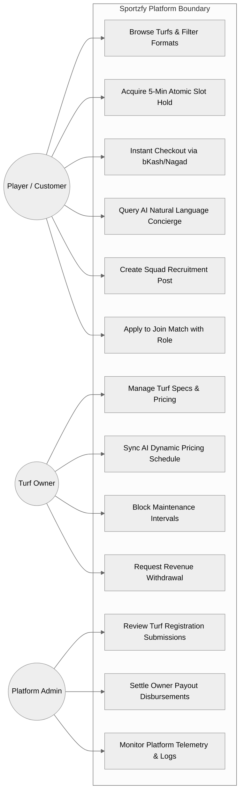

---

### Diagram 2: Static Model — Complete Domain Class Diagram (Section 3.4)
*Complete object-oriented domain model displaying core entities, service controllers, attributes, methods, and multiplicities.*

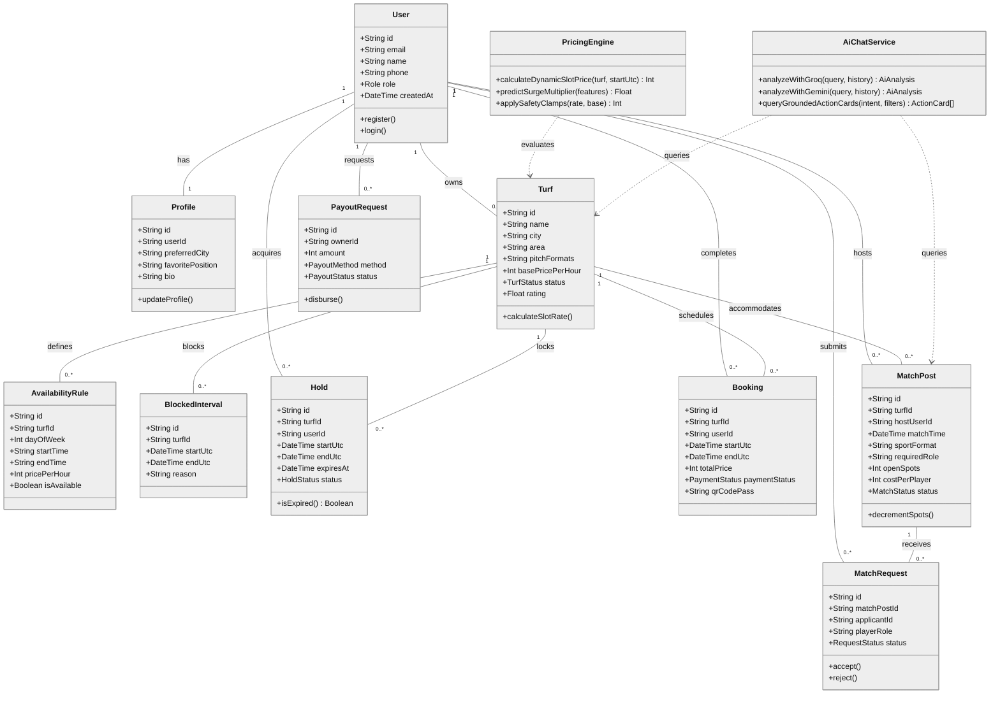

---

### Diagram 3: Database Entity-Relationship (ER) Diagram (Section 5.3)
*Crow's Foot Relational Schema covering all 11 tables in Neon PostgreSQL with primary keys, foreign keys, and cardinalities.*

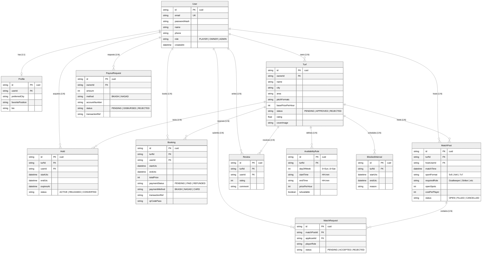

---

# 2. Pillar 1: Atomic Slot Hold & Concurrency Defense

### Diagram 4: Feature 1 Use Case Diagram (Section 3.2)
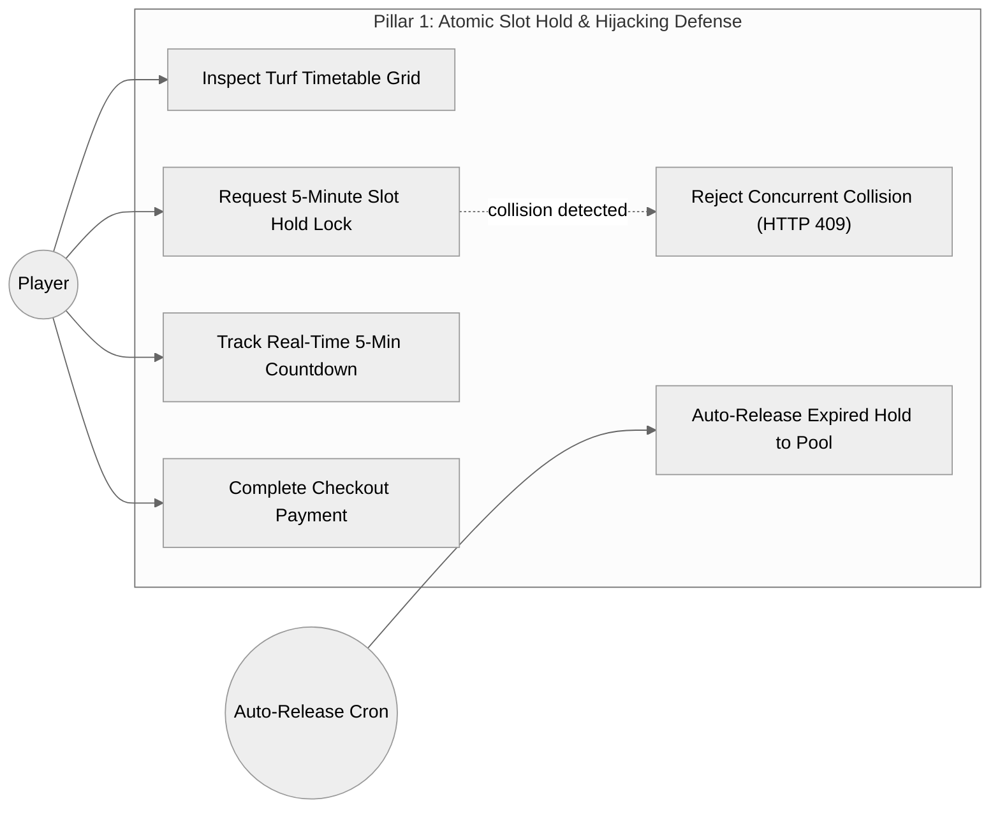

---

### Diagram 5: Feature 1 Activity Diagram with Swimlanes (Section 3.3)
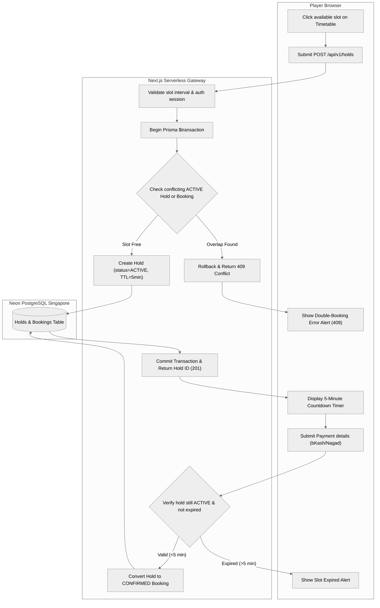

---

### Diagram 6: Feature 1 Sequence Diagram (Section 3.5 & `TC-HOLD-01`)
*Demonstrates simultaneous race-condition resolution between Player A and Player B.*

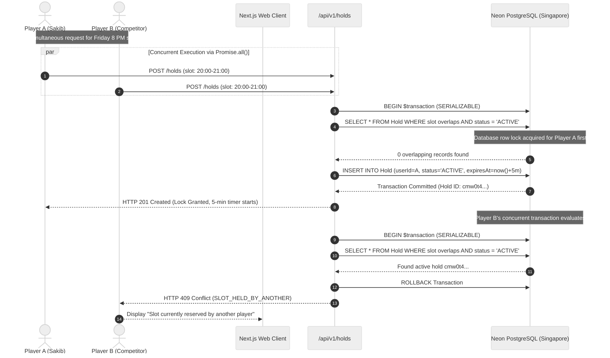

---

# 3. Pillar 2: Squad Recruitment & Matchmaking

### Diagram 7: Feature 2 Use Case Diagram (Section 3.2)
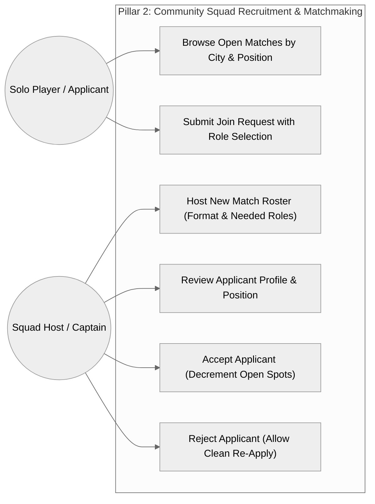

---

### Diagram 8: Feature 2 Activity Diagram with Swimlanes (Section 3.3)
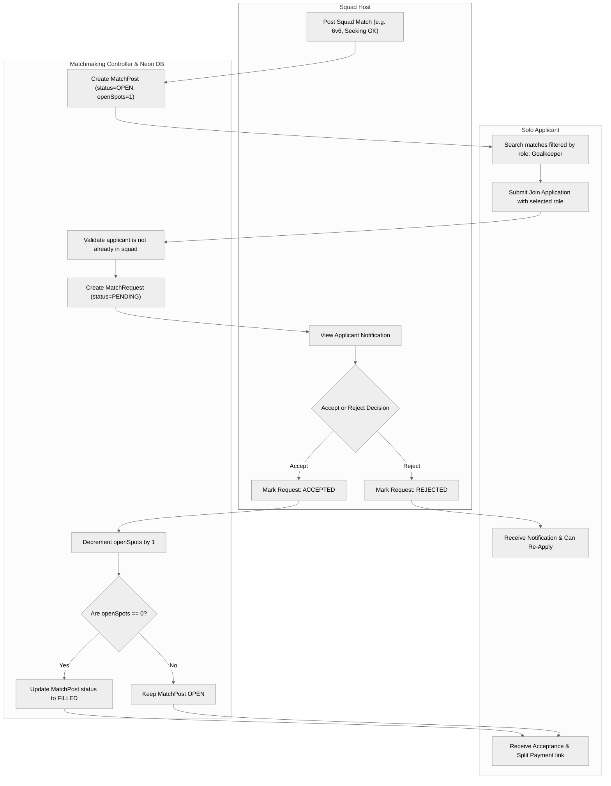

---

### Diagram 9: Feature 2 Sequence Diagram (Section 3.5 & `TC-MATCH-02`)
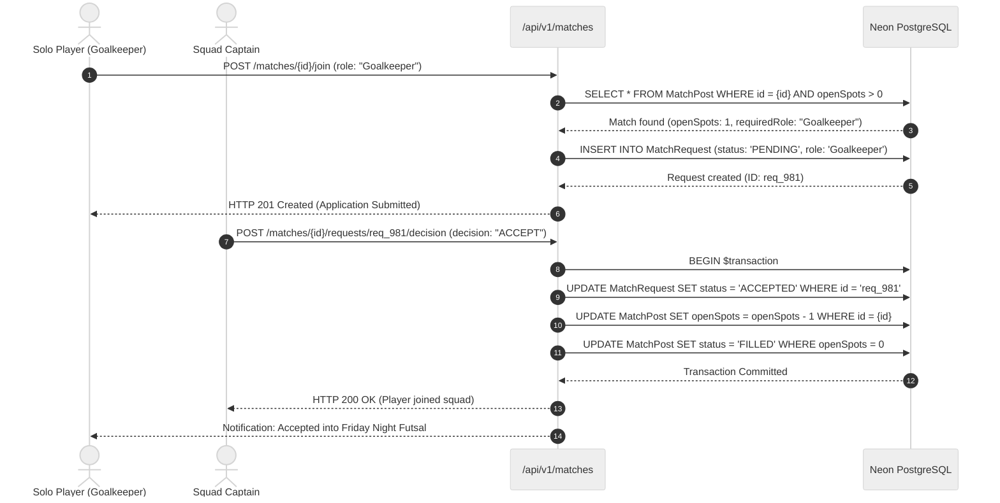

---

# 4. Pillar 3: Machine Learning Dynamic Pricing

### Diagram 10: Feature 3 Use Case Diagram (Section 3.2)
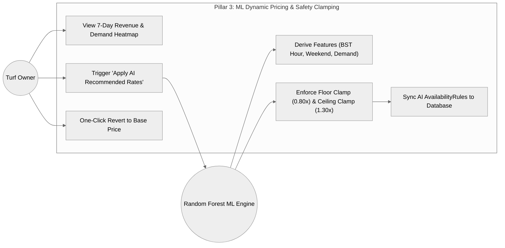

---

### Diagram 11: Feature 3 Activity Diagram with Swimlanes (Section 3.3)
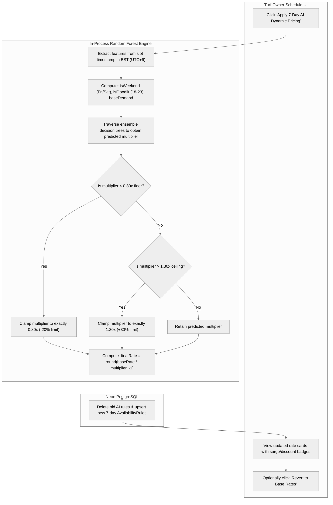

---

### Diagram 12: Feature 3 Sequence Diagram (Section 3.5 & `TC-AI-PRICE-01`)
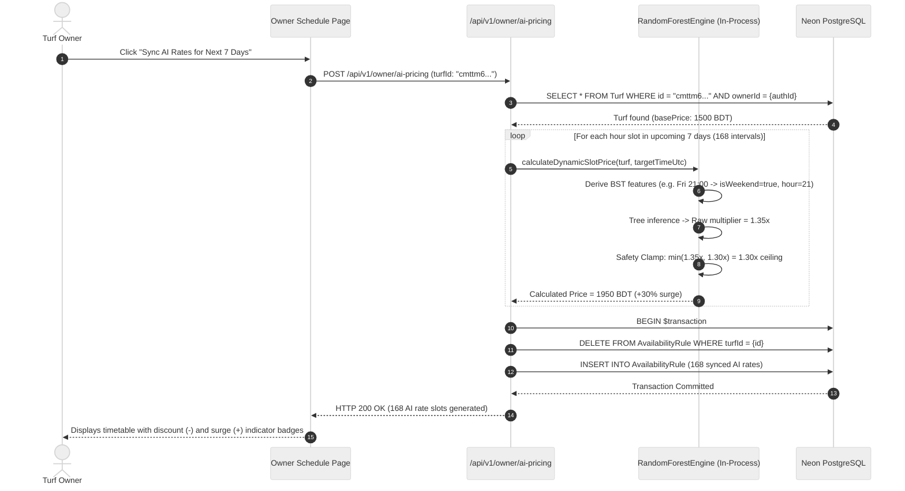

---

# 5. Pillar 4: AI Conversational Concierge

### Diagram 13: Feature 4 Use Case Diagram (Section 3.2)
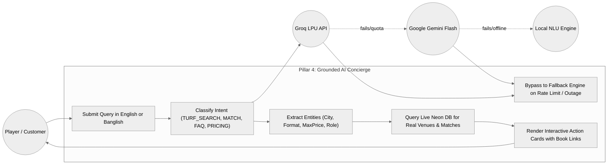

---

### Diagram 14: Feature 4 Activity Diagram with Swimlanes (Section 3.3)
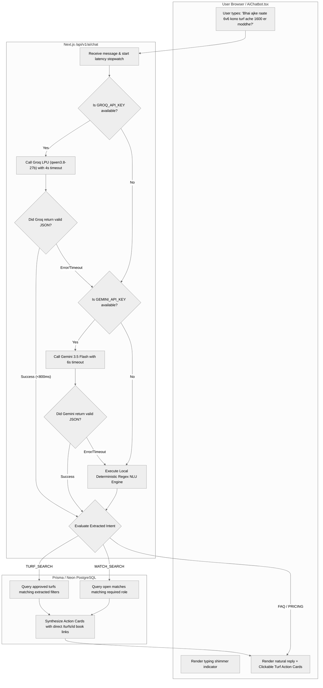

---

### Diagram 15: Feature 4 Sequence Diagram (Section 3.5 & `TC-AI-CHAT-01`)
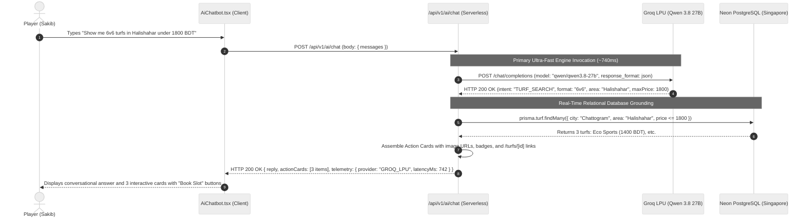

---

# 6. Architecture & Pipeline Diagrams

### Diagram 16: High-Level System Architecture Diagram (Section 4.2)
*Layered 3-tier Serverless Next.js App Router Architecture.*

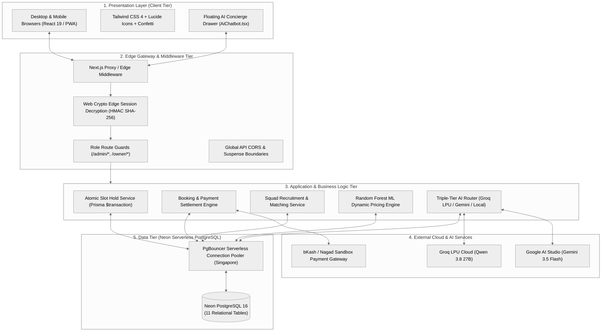

---

### Diagram 17: AI-Integration Architecture Diagram (Section 4.4)
*Dual-Engine AI architecture illustrating the predictive ML model alongside the generative conversational RAG pipeline.*

```mermaid
%%{init: {'theme': 'neutral'}}%%
flowchart TB
    subgraph PredictiveEngine["A. Predictive AI: Machine Learning Dynamic Pricing"]
        OwnerTrigger["Owner Schedules AI Pricing"] --> FeatureDerivation["BST Timezone Feature Derivation\n(dayOfWeek, hour, isWeekend, baseDemand)"]
        FeatureDerivation --> TreeModel["In-Process Random Forest Decision Trees\n(lib/pricing-ml.ts, <1ms SLA)"]
        TreeModel --> ClampLogic["Mathematical Safety Clamp Guardrail\nFloor: 0.80x (৳1200) | Ceiling: 1.30x (৳1800)"]
        ClampLogic --> DBCommit["Persist 7-Day Synced Rates in Neon DB"]
    end

    subgraph GenerativeEngine["B. Generative AI: Conversational Booking Concierge (RAG)"]
        UserMsg["User Message (English / Banglish)"] --> AIRouter["AI API Gateway (/api/v1/ai/chat)"]
        
        AIRouter --> Tier1{"1. Groq LPU API\n(Qwen 3.8 27B)"}
        Tier1 -- "Success (~750ms)" --> IntentExtractor["Structured Intent & Filter Extraction"]
        Tier1 -- "Rate Limit / 503" --> Tier2{"2. Gemini 3.5 Flash\n(Google AI Studio)"}
        Tier2 -- "Success (~1.8s)" --> IntentExtractor
        Tier2 -- "Offline / Timeout" --> Tier3["3. Deterministic Local NLU\n(Regex Intent Classifier)"]
        Tier3 --> IntentExtractor

        IntentExtractor --> GroundingDB[("Neon Relational DB Query\n(Turfs & Open Matches)")]
        GroundingDB --> ActionCardSynth["Action Card Synthesizer\n(Images, format, direct /turfs/id book links)"]
        ActionCardSynth --> ClientChat["Interactive UI Response Drawer"]
    end
```

---

### Diagram 18: CI/CD Pipeline & Git Management Workflow (Section 4.4 & 4.5)
```mermaid
%%{init: {'theme': 'neutral'}}%%
flowchart LR
    Dev["Developer Workstation"] --> LocalTest["Local Test Verification\n(npm test -> 36 suites PASS)"]
    LocalTest --> GitCommit["Atomic Git Commit\n(feat/fix convention)"]
    GitCommit --> GitHubPush["Push to GitHub\n(origin/main)"]

    subgraph GitHubActions["GitHub Version Control"]
        GitHubPush --> Webhook["Deployment Webhook Trigger"]
    end

    subgraph VercelCI["Vercel Cloud CI/CD Engine"]
        Webhook --> TurbopackBuild["Turbopack Next.js Build\n(34 Static/Dynamic Routes)"]
        TurbopackBuild --> PrerenderCheck["Static Prerender Verification\n(useSearchParams Suspense check)"]
        PrerenderCheck --> EdgeDeploy["Deploy to Global Edge Network"]
    end

    subgraph ProductionLive["Live Production Runtime"]
        EdgeDeploy --> LiveApp["https://sportzfy-zeta.vercel.app"]
        LiveApp <--> LiveNeonDB[("Neon PostgreSQL Singapore")]
    end
```

---

### Diagram 19: Physical Deployment Diagram (Appendix E)
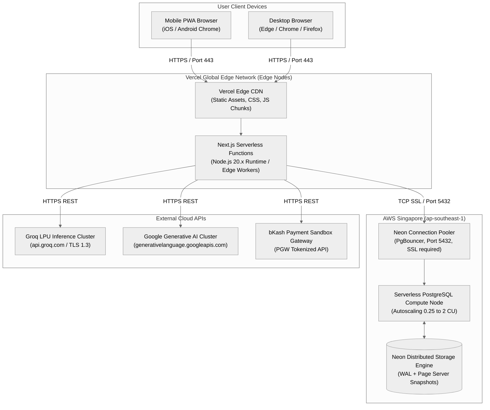

---

# 7. Project Management & UI Flow Diagrams

### Diagram 20: Project Timeline & Milestone Gantt Chart (Section 2.6)
*7-week sprint schedule mapped across planning, architecture, implementation, testing, and deployment.*

```mermaid
%%{init: {'theme': 'neutral'}}%%
gantt
    title Sportzfy CSE-355 7-Week Project Lifecycle
    dateFormat  YYYY-MM-DD
    section Phase 1: Inception
    Problem Research & Community Survey (25 respondents) :done, p1_1, 2026-08-01, 2026-08-08
    Proposal Document & Requirement Analysis             :done, p1_2, 2026-08-08, 2026-08-15
    section Phase 2: Design
    System Architecture & HLD/LLD Specification          :done, p2_1, 2026-08-15, 2026-08-22
    Neon PostgreSQL Schema & Prisma ERD Modeling         :done, p2_2, 2026-08-22, 2026-08-29
    section Phase 3: Construction
    Sprint 1: Auth (Web Crypto HMAC) & Turf Catalog      :done, p3_1, 2026-08-29, 2026-09-08
    Sprint 2: 5-Min Atomic Slot Hold & Concurrency Lock  :done, p3_2, 2026-09-08, 2026-09-18
    Sprint 3: Community Matchmaking with Role Selection  :done, p3_3, 2026-09-18, 2026-09-28
    Sprint 4: ML Dynamic Pricing with Safety Clamps      :done, p3_4, 2026-09-28, 2026-10-08
    Sprint 5: Dual AI Concierge (Groq LPU + Gemini Flash):done, p3_5, 2026-10-08, 2026-10-18
    section Phase 4: QA & Live
    Automated Test Suite (36 suites) & Concurrency Test  :done, p4_1, 2026-10-18, 2026-10-25
    Vercel Edge Production Deployment & Go-Live Audit    :done, p4_2, 2026-10-25, 2026-11-01
    Final Lab Report & Defense Preparation               :active, p4_3, 2026-11-01, 2026-11-06
```

---

### Diagram 21: GUI Information Architecture & User Journey Flow (Section 5.4)
```mermaid
%%{init: {'theme': 'neutral'}}%%
flowchart TD
    Landing["/ (Homepage & Turf Catalog)"]

    subgraph PlayerFlow["Player Booking & Match Flow"]
        TurfDetail["/turfs/[id] (Pitch Specs, Timetable Grid)"]
        CheckoutHold["/checkout/[holdId] (5-Min Countdown Timer)"]
        PaymentSuccess["Booking Confirmed (Digital QR Pass)"]
        MatchesCatalog["/matches (Open Squad Roster)"]
        JoinMatch["Apply with Position (GK/Striker)"]
        AiDrawer["Floating AI Concierge Drawer (Action Cards)"]
    end

    subgraph OwnerFlow["Venue Owner Management"]
        OwnerHome["/owner (Analytics & Quick Stats)"]
        ScheduleManager["/owner/schedule (Grid & AI Sync)"]
        BlockedIntervals["Slot Blocking for Maintenance"]
        PayoutRequests["Withdrawal Requests (bKash/Nagad)"]
    end

    subgraph AdminFlow["Platform Moderation"]
        AdminHome["/admin (System Overview)"]
        TurfReview["Review & Approve Venue Submissions"]
        PayoutSettlement["Process & Disburse Owner Payouts"]
    end

    Landing --> TurfDetail
    Landing --> MatchesCatalog
    Landing --> AiDrawer
    AiDrawer -->|Direct Action Link| TurfDetail
    AiDrawer -->|Direct Action Link| MatchesCatalog

    TurfDetail -->|Click Slot -> Acquire Hold| CheckoutHold
    CheckoutHold -->|Pay via bKash/Nagad| PaymentSuccess
    MatchesCatalog --> JoinMatch

    Landing -->|Owner Login| OwnerHome
    OwnerHome --> ScheduleManager
    OwnerHome --> BlockedIntervals
    OwnerHome --> PayoutRequests

    Landing -->|Admin Login| AdminHome
    AdminHome --> TurfReview
    AdminHome --> PayoutSettlement
```

---

### Diagram 22: High-Level Design (HLD) Design Patterns in Action (Section 5.1)
```mermaid
%%{init: {'theme': 'neutral'}}%%
classDiagram
    direction LR

    class RepositoryPattern {
        <<Pattern>>
        PrismaClient Singleton
        Centralized DB abstraction
        Prevents connection exhaustion
    }

    class StrategyPattern {
        <<Pattern>>
        PricingStrategy
        +BaseRateStrategy()
        +WeekendSurgeStrategy()
        +RandomForestMLStrategy()
    }

    class FallbackObserverPattern {
        <<Pattern>>
        TripleTierAIRouter
        +NotifyGroq()
        +FallbackGemini()
        +FallbackLocalNLU()
    }

    class FactoryPattern {
        <<Pattern>>
        ActionCardFactory
        +createTurfCard()
        +createMatchCard()
    }

    RepositoryPattern <.. StrategyPattern : queries
    StrategyPattern <.. FallbackObserverPattern : coordinates
    FallbackObserverPattern <.. FactoryPattern : renders
```

