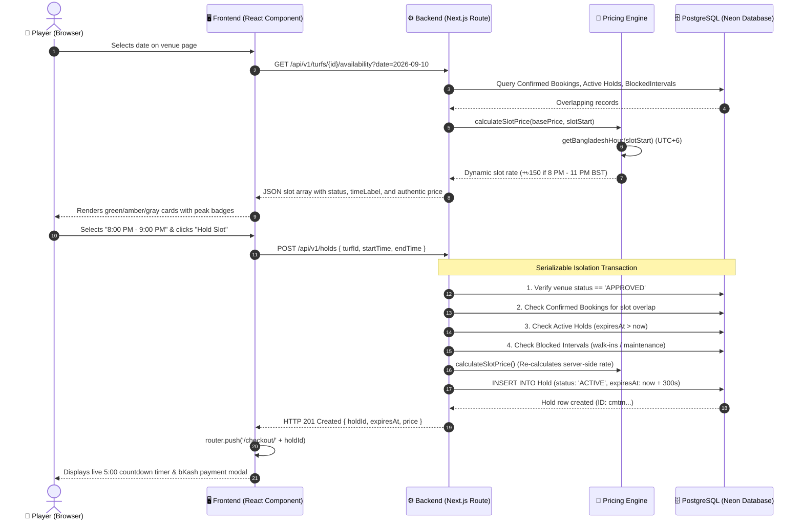

# Sportzfy System Architecture & End-to-End Data Flow

This document provides a comprehensive technical breakdown of how the **Frontend**, **Backend**, and **Database** work together in Sportzfy across its primary domain workflows.

---

## 🏗️ High-Level Technology Stack

```
┌─────────────────────────────────────────────────────────┐
│                    Frontend Layer                       │
│  Next.js 16 (React 19 App Router) • Tailwind CSS v4     │
│  Client Components ('use client') & Lucide Icons        │
└────────────────────────────┬────────────────────────────┘
                             │ HTTP JSON Fetch / REST
                             ▼
┌─────────────────────────────────────────────────────────┐
│                    Backend Layer                        │
│  Next.js Route Handlers (Edge & Node.js Runtimes)       │
│  BST Pricing Engine • HMAC Session Auth • bcryptjs      │
└────────────────────────────┬────────────────────────────┘
                             │ Prisma Client v6 (Pooled / SSL)
                             ▼
┌─────────────────────────────────────────────────────────┐
│                    Database Layer                       │
│  Neon Serverless PostgreSQL (ap-southeast-1)            │
│  Serializable Isolation • ACID Transactions • Indexes   │
└─────────────────────────────────────────────────────────┘
```

---

## 📌 Use Case 1: Slot Availability & Atomic 5-Minute Checkout Lock

This flow demonstrates how a player views a venue's real-time timetable, dynamic peak pricing is applied server-side, and an atomic 5-minute lock prevents race conditions and double-booking.

### Flow Diagram



### 1. Frontend Interaction (`app/turfs/[id]/page.tsx`)
1. **Trigger:** The player selects a date on the calendar input.
2. **State Management:**
   ```tsx
   const [selectedDate, setSelectedDate] = useState("2026-09-10");
   const [slots, setSlots] = useState<Slot[]>([]);
   const [holdingSlot, setHoldingSlot] = useState(false);
   ```
3. **Fetching Timetable:**
   A React `useEffect` calls `GET /api/v1/turfs/${id}/availability?date=${selectedDate}`. The slots are parsed and rendered into status cards:
   - `AVAILABLE`: Emerald badge with hourly price, clickable for checkout.
   - `HELD`: Amber badge with *"In Checkout"* notice.
   - `BOOKED`: Muted gray badge with *"Reserved"*.
   - `BLOCKED`: Crimson badge with *"Locked by Owner"*.
4. **Lock Request:**
   When the user selects a slot and clicks *"Secure Slot for 5 Minutes"*, the client posts `turfId`, `startTime`, and `endTime` to `/api/v1/holds`.

### 2. Backend Logic & Pricing Engine (`app/api/v1/turfs/[id]/availability/route.ts` & `lib/pricing.ts`)
1. **Timezone Invariance (Bangladesh Standard Time, UTC+6):**
   To prevent Vercel UTC discrepancies, the backend constructs deterministic UTC timestamps:
   ```ts
   // In BST (UTC+6), UTC hour = h - 6
   const slotStart = new Date(Date.UTC(year, month, day, h - 6, 0, 0));
   const slotEnd = new Date(Date.UTC(year, month, day, h + 1 - 6, 0, 0));
   ```
2. **Dynamic Peak Window:**
   The pricing engine determines the hour in Dhaka using `Intl.DateTimeFormat`:
   ```ts
   const bstHour = getBangladeshHour(slotStart);
   const isPeakHour = bstHour >= 20 && bstHour <= 23; // 8 PM to 11 PM BST
   const price = basePricePerHour + (isPeakHour ? 150 : 0);
   ```
3. **Temporal Boundary Enforcement:**
   `validateSlotTimes()` verifies:
   - Start time is in the future.
   - Slot is within the 14-day booking window.
   - Duration does not exceed `MAX_BOOKING_DURATION_HOURS = 4`.

### 3. Database Layer & Concurrency Protection (`app/api/v1/holds/route.ts`)
1. **Serializable ACID Isolation:**
   Hold acquisition runs inside a transaction with PostgreSQL serializable isolation:
   ```ts
   await prisma.$transaction(async (tx) => {
     // Check conflicting active hold
     const conflictingHold = await tx.hold.findFirst({
       where: {
         turfId,
         status: "ACTIVE",
         expiresAt: { gt: new Date() },
         startTime: { lt: slotEnd },
         endTime: { gt: slotStart },
       },
     });
     if (conflictingHold) throw new Error("SLOT_HELD_BY_ANOTHER");

     return await tx.hold.create({
       data: {
         turfId,
         userId: currentUser.id,
         startTime: slotStart,
         endTime: slotEnd,
         price: authenticPrice,
         expiresAt: new Date(Date.now() + 5 * 60 * 1000), // 5 min TTL
         status: "ACTIVE",
       },
     });
   }, {
     isolationLevel: Prisma.TransactionIsolationLevel.Serializable,
   });
   ```
2. **Race Condition Resolution:**
   If Player A and Player B click the exact same slot simultaneously:
   - **Player A:** Wins the lock, receives HTTP 201, and proceeds to checkout.
   - **Player B:** Transaction detects serialization conflict or active hold, aborts, and returns HTTP 409 Conflict. Player B is notified that another user is checking out.

---

## 📌 Use Case 2: Community Squad Recruitment & Captain Roster Management

This flow demonstrates how a captain recruits players for a 7v7 match, an applicant submits their preferred role, and the captain approves or declines the request with automatic spot counter synchronization.

### Flow Diagram

```mermaid
sequenceDiagram
    autonumber
    actor Applicant as ⚽ Applicant Player
    actor Captain as 👑 Match Host / Captain
    participant FE as 🖥️ Frontend (Matches UI)
    participant API as ⚙️ Backend (Match API)
    participant DB as 🗄️ PostgreSQL (Neon Database)

    Applicant->>FE: Views /matches & selects "Join Squad"
    FE->>API: POST /api/v1/matches/{id}/join { preferredRole: "Midfielder" }
    API->>DB: Verify match is OPEN and openSpots > 0
    API->>DB: Verify hostUserId != currentUser.id (Host cannot join own match)
    API->>DB: Check existing JoinRequest
    alt If applicant was previously REJECTED
        API->>DB: UPDATE JoinRequest SET status = 'PENDING', preferredRole = 'Midfielder'
    else First application
        API->>DB: INSERT INTO JoinRequest (status: 'PENDING', preferredRole: 'Midfielder')
    end
    DB-->>API: JoinRequest row saved
    API-->>FE: HTTP 201 "Join request sent to captain!"
    FE-->>Applicant: Shows "Request Pending" badge

    Captain->>FE: Opens /matches/{id} (Match Detail & Lineup)
    FE->>API: GET /api/v1/matches/{id}
    API->>DB: Query MatchPost with host, turf, joinRequests, and user profiles
    DB-->>API: Match data with pending applicants
    API-->>FE: Match details JSON
    FE-->>Captain: Renders Captain Controls with [Accept] and [Decline] buttons

    Captain->>FE: Clicks [Accept Player]
    FE->>API: POST /api/v1/matches/{id}/requests/{reqId}/decision { decision: "ACCEPTED" }
    Note over API,DB: Atomic Prisma Transaction
    API->>DB: 1. Verify joinReq.matchPostId == id (Cross-match guard)
    API->>DB: 2. Verify matchPost.hostUserId == currentUser.id (Owner guard)
    API->>DB: 3. UPDATE JoinRequest SET status = 'ACCEPTED'
    API->>DB: 4. UPDATE MatchPost SET openSpots = openSpots - 1 (Sets status = 'FULL' if 0)
    DB-->>API: Transaction committed
    API-->>FE: HTTP 200 "Player added to squad! Open spots updated."
    FE-->>Captain: Open spots counter decrements; player moved to Confirmed Squad
```

### 1. Frontend Interaction (`app/matches/page.tsx` & `app/matches/[id]/page.tsx`)
1. **Match Discovery:** Players browse `/matches` to find squads needing players (e.g., *"Friday 7v7 - Need 2 Defenders"*).
2. **Submitting Application:**
   The player clicks *"Request to Join"*, picks their position (`Goalkeeper`, `Defender`, `Midfielder`, `Striker`), and submits.
3. **Captain Panel:**
   When the host navigates to `/matches/[id]`, the page detects `currentUser.id === match.hostUserId` and renders:
   - Pending applicants list with applicant name, phone number, and preferred role.
   - Action buttons: **Accept to Squad** and **Decline**.
   - Live roster bar: e.g., `"12/14 Confirmed • 2 Spots Open"`.

### 2. Backend Logic (`app/api/v1/matches/[id]/join/route.ts`)
1. **Host Guard:** Prevents match creators from submitting join requests to their own match:
   ```ts
   if (match.hostUserId === currentUser.id) {
     return NextResponse.json(
       { error: { code: "HOST_CANNOT_JOIN", message: "You are the captain and already in the squad." } },
       { status: 400 }
     );
   }
   ```
2. **Re-Application Lifecycle Handling:**
   Prisma enforces `@@unique([matchPostId, userId])`. If an applicant was previously rejected and re-applies, the route resets the existing row to `PENDING` rather than throwing a duplicate key error:
   ```ts
   if (existing && existing.status === "REJECTED") {
     const updated = await prisma.joinRequest.update({
       where: { id: existing.id },
       data: { status: "PENDING", preferredRole },
     });
     return NextResponse.json({ data: updated, message: "Request resubmitted!" });
   }
   ```

### 3. Database Layer & Roster Synchronization (`app/api/v1/matches/[id]/requests/[requestId]/decision/route.ts`)
1. **URL Anti-Tampering Check:**
   Ensures the join request belongs to the match ID in the URL:
   ```ts
   if (joinReq.matchPostId !== id) throw new Error("MISMATCHED_MATCH_ID");
   ```
2. **Atomic Bidirectional Counter Updates:**
   ```ts
   await prisma.$transaction(async (tx) => {
     // 1. Update JoinRequest status
     const updated = await tx.joinRequest.update({
       where: { id: requestId },
       data: { status: decision },
     });

     // 2. If newly accepted, decrement spots
     if (decision === "ACCEPTED" && joinReq.status !== "ACCEPTED") {
       const newOpenSpots = Math.max(0, joinReq.matchPost.openSpots - 1);
       await tx.matchPost.update({
         where: { id: joinReq.matchPostId },
         data: {
           openSpots: newOpenSpots,
           ...(newOpenSpots === 0 && { status: "FULL" }),
         },
       });
     }

     // 3. If accepted player is removed, restore spot
     if (decision === "REJECTED" && joinReq.status === "ACCEPTED") {
       const newOpenSpots = Math.min(joinReq.matchPost.totalSpots, joinReq.matchPost.openSpots + 1);
       await tx.matchPost.update({
         where: { id: joinReq.matchPostId },
         data: { openSpots: newOpenSpots, status: "OPEN" },
       });
     }

     return updated;
   });
   ```

---

## 📌 Use Case 3: Authentication, Session Management & Automatic Password Migration

This flow demonstrates how user credentials are encrypted with `bcryptjs`, sessions are signed with HMAC-SHA256, and legacy seed accounts are automatically upgraded.

### Flow Diagram

```mermaid
sequenceDiagram
    autonumber
    actor User as 👤 User
    participant FE as 🖥️ Frontend (/login or /register)
    participant API as ⚙️ Backend (Auth Route)
    participant Crypto as 🔐 Cryptographic Engine
    participant DB as 🗄️ PostgreSQL (User Table)

    User->>FE: Enters email & password
    FE->>API: POST /api/v1/auth/login { email, password }
    API->>DB: SELECT * FROM User WHERE email = cleanEmail
    DB-->>API: User record (with password hash)
    alt Stored password starts with $2a$ / $2b$
        API->>Crypto: bcrypt.compare(password, user.password)
    else Legacy plaintext password
        API->>Crypto: crypto.timingSafeEqual(userPassBuf, inputPassBuf)
        API->>Crypto: bcrypt.hash(password, 10)
        API->>DB: UPDATE User SET password = newHash (Auto-migration)
    end
    Crypto-->>API: Password matches
    API->>Crypto: encodeSession(user)
    Crypto->>Crypto: HMAC-SHA256(payloadBase64, SESSION_SECRET)
    Crypto-->>API: Signed token: payloadBase64.hmacSignature
    API->>FE: HTTP 200 with Set-Cookie (sportzfy_session; HttpOnly; SameSite=lax; Max-Age=7d)
    FE->>FE: Automatically routes user based on role (Admin -> /admin, Owner -> /owner, Player -> /)
```

### Key Security Implementations

1. **Bcrypt Password Storage:**
   All new registrations in [`app/api/v1/auth/register/route.ts`](file:///c:/Users/alifs/Downloads/swe_project/sportzfy-web/app/api/v1/auth/register/route.ts) hash passwords with 10 salt rounds before insertion.
2. **Zero-Downtime Auto-Migration:**
   In [`app/api/v1/auth/login/route.ts`](file:///c:/Users/alifs/Downloads/swe_project/sportzfy-web/app/api/v1/auth/login/route.ts), if an existing seed account still has a legacy password, it validates via `crypto.timingSafeEqual` and immediately updates the database row with a fresh bcrypt hash.
3. **Session Signing & 7-Day TTL Expiration:**
   In [`lib/session-token.ts`](file:///c:/Users/alifs/Downloads/swe_project/sportzfy-web/lib/session-token.ts), session cookies contain a Base64 JSON payload and an HMAC-SHA256 signature. On every request, `decodeSession()` verifies:
   - Cryptographic signature validity using constant-time comparison.
   - Token timestamp is not older than 7 days (`SESSION_MAX_AGE_MS = 604,800,000 ms`).
4. **Edge Middleware Guarding:**
   [`middleware.ts`](file:///c:/Users/alifs/Downloads/swe_project/sportzfy-web/middleware.ts) inspects incoming requests using Edge Web Crypto API (`lib/edge-auth.ts`) to enforce RBAC on `/admin` and `/owner` routes before the page even executes.

---

## 📊 Summary of Architectural Invariants

| Invariant | Implementation Mechanism | Benefit |
|---|---|---|
| **No Double Booking** | PostgreSQL `SERIALIZABLE` transaction isolation in `holds/route.ts` | Eliminates concurrent race conditions when two users click the same slot. |
| **Tamper-Proof Pricing** | Server-authoritative `calculateSlotPrice` in `lib/pricing.ts` | Prevents clients from manipulating slot rates in request payloads. |
| **Timezone Determinism** | UTC offset math based on `Asia/Dhaka` (UTC+6) in `availability/route.ts` | Displays identical and correct slot times on Vercel UTC and local servers alike. |
| **Roster Consistency** | Atomic increment/decrement inside Prisma transaction in `decision/route.ts` | Open spots cannot drop below 0 or exceed the total capacity. |
| **Credential Safety** | Bcrypt hashing + constant-time comparison + 7-day TTL token validation | Protects against plaintext leaks, timing attacks, and indefinite session hijacking. |
